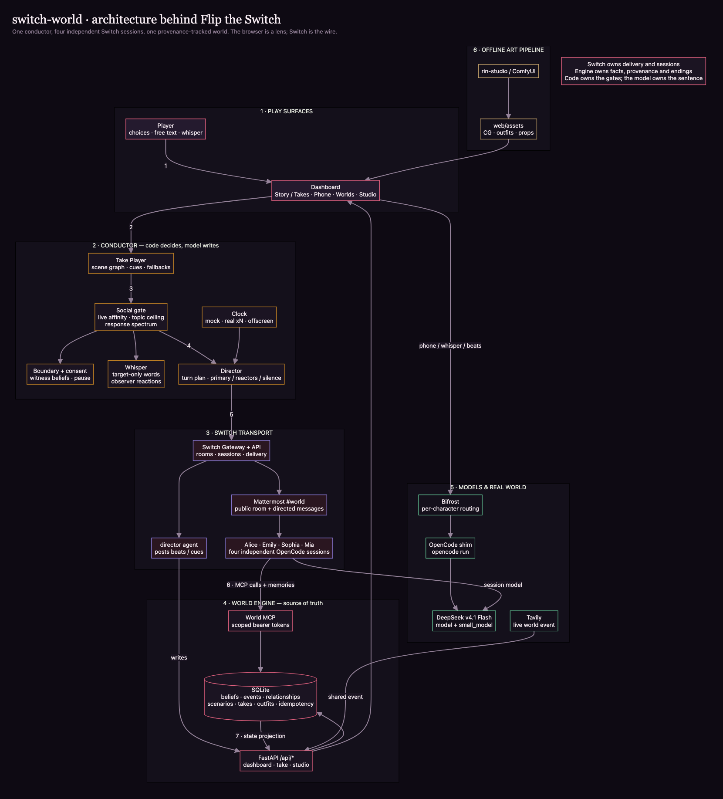

# switch-world

A **Switch-native AI social world**. Four characters share a group chat, keep private
memories, and live in a public feed. You meet them **in a scene** — sprites, stage
performance, authored choices, a free-text line — and only after you add someone as a
friend does their **phone** unlock. A **time machine** can fast-forward the story in mock
time or run it against the wall clock, and every belief still carries provenance.

**MCP-first:** the world engine is an MCP server, and the cast's only write path is
`world__remember` / `world__update_relationship`. Each character carries a scoped bearer
token; the server maps it to that character and refuses another character's private
beliefs at the API layer. Switch is the transport; the scene card is the artifact.

**Recording today:** the four-minute cut, the tab board and the pre-flight checklist are
in [`docs/DEMO_TODAY.md`](docs/DEMO_TODAY.md) and [`demo-links.html`](demo-links.html).

**Play the guest demo:** <https://switch-demo-rin.duckdns.org> (basic auth `guest`, then
the guest password). The VM runs the same FastAPI/MCP world engine and dashboard. No
Switch Console runs in the cloud, so the site sets `WORLD_AGENT_MODE=cloud`: the group
room, whisper and DM keep the same planning, addressing and recording path, and each
planned speaker answers through one DeepSeek call with the operator's key. Locally the
same code path is served by the four live Switch agent sessions. `#world` stays bridged
at `/mattermost`. Deployment and test steps are in
[`deploy/demo/README.md`](deploy/demo/README.md).

## MCP is the interface

The world engine (`switch_world/`) is an **MCP server first**. The dashboard, the director
and the HTTP API are clients of the same store; the cast acts only through the fourteen
tools below. The names, argument order, defaults and result shapes are the public MCP
contract, pinned by `tests/interfaces/test_mcp_tools.py` and documented in
[`docs/MCP.md`](docs/MCP.md). The server is built by
`switch_world.interfaces.mcp.server.create_mcp` and served at `POST /mcp` (streamable HTTP)
on `127.0.0.1:8890`.

### Scoped-token guarantee

Every MCP request carries a per-character bearer token. The server maps the token to
exactly one actor at the edge with a constant-time compare, and **no tool accepts a
character id from the caller**. Authorization is enforced again in the store, not in the
prompt:

- a character can read only its own beliefs and the public facts it is allowed to see;
- `world__remember` always writes a belief held by the authenticated caller;
- `world__update_relationship` can move only the caller's outgoing edge;
- `world__give_item` is rejected unless the caller currently holds the item;
- `world__record_event` and `world__who_knows` are director-only, so a character cannot
  forge a public turn or inspect the full matrix.

"That Alice knows something Emily does not" is therefore an API property even if a model is
prompt-injected or confused. See [`docs/MCP.md`](docs/MCP.md) for the per-tool rules.

### The fourteen tools

| # | Tool | Caller | Input | Output |
| --- | --- | --- | --- | --- |
| 1 | `world__recall` | character | `query: str`, `limit: int = 8` | ranked beliefs + relationship facts the caller may see |
| 2 | `world__search_web` | character | `query: str`, `max_results: int = 5`, `topic: str = "news"` | Tavily results (titles, URLs, snippets, offline flag) |
| 3 | `world__remember` | character | `proposition: str`, `source: str`, `confidence: float = 0.8`, `visibility: str = "private"`, `proposition_key: str?` | the stored belief |
| 4 | `world__relationship` | character | `other: str` | trust / closeness / tension from the caller's view |
| 5 | `world__update_relationship` | character | `other: str`, `trust_delta: float`, `closeness_delta: float`, `tension_delta: float`, `reason: str` | the updated edge and the event id |
| 6 | `world__record_event` | director | `kind: str`, `summary: str`, `participants: list[str]?`, `visibility: str = "public"` | event id |
| 7 | `world__who_knows` | director | `proposition_key: str` | every holder, source, confidence and timestamp |
| 8 | `world__set_outfit` | character | `outfit_id: str`, `reason: str`, `source_belief_id: str?` | the stored outfit |
| 9 | `world__give_item` | holder or director | `item_id: str`, `to: str`, `note: str?` | the moved item |
| 10 | `world__allowed_looks` | character | — | the outfits this scenario declares for the caller |
| 11 | `world__connections` | any | — | the cast↔cast relationship projection |
| 12 | `world__items` | any | — | the props/items in the world and who holds them |
| 13 | `world__ending_status` | any | — | the active scenario's ending card |
| 14 | `world__advance_time` | director | `minutes: int` | the new world clock |

The fourteen tools are the MCP surface advertised by v2.0.0-rc. The four `world://`
read-resource URIs sketched in early drafts (`characters`, `beliefs`, `relationships`,
`events`) are not registered on the server yet; clients read the same data through these
tools and the read-only HTTP projections.

### Adapter map

Ports are declared in `switch_world/domain/ports/` and depend on the standard library only.
`switch_world/container.py` is the single composition root that names a concrete adapter;
no HTTP route or MCP tool constructs a provider client.

| Port | Local / dev | Cloud (`WORLD_AGENT_MODE=cloud`) | Test doubles |
| --- | --- | --- | --- |
| `WorldStore` (`reader` / `writer` / `admin`) | `SqliteWorldStore` | `SqliteWorldStore` | the same SQLite adapter on a `tmp_path`; `WorldService` is the facade |
| `CharacterTransport` | `SwitchTransport` (`switch`) / `LocalRoomTransport` (`local`) | `CloudRoomTransport` | `LocalRoomTransport`, `FakeSwitch`, `respx` wire mocks |
| `ModelClient` | `BifrostModelClient` | `DeepSeekModelClient` | `ScriptedModelClient`, in-test `FakeBifrost` / `FakeModel` |
| `Clock` | `SystemClock` | `SystemClock` | in-test `FakeClock` / `FakeTime` |
| `ArtifactStore` | `FileArtifactStore(export_dir)` | `FileArtifactStore` | the same adapter pointed at `tmp_path` |
| `ContentStore` | `FileContentStore(content_root)` | `FileContentStore(content_root)` | the same adapter pointed at the checkout |

`SwitchTransport` is the live path (`write_mode=out_of_band`, writes arrive through the
character's own MCP token); `CloudRoomTransport` generates planned replies concurrently and
returns an in-band JSON envelope with the same authority a character has through MCP. Both
satisfy the contract in `tests/contract/test_transport_contract.py`.

### make check

`make check` is the single local gate. It runs:

```sh
make check     # lint + test + web
make lint      # ruff check switch_world tests, then compileall
make test      # .venv/bin/python -m pytest -q
make web       # node --check on web/cast.js and web/js/*.js; node --test; contract drift check
make cov       # pytest --cov=switch_world --cov-report=term-missing
```

Coverage is measured separately with pytest-cov; v2 is at **85%** (6065 / 7119
statements). CI runs the same lint, the 3.11/3.12/3.13 test matrix, the dashboard syntax
job and the wheel-install smoke.

### v2 status

The current branch is `v2-architecture`, tagged `v2.0.0-rc`. It is **not merged and not
deployed**: `main` and `geekroom` are unchanged and the public demo still runs the
`geekroom` edition. The ports-and-adapters refactor replaced the v1 `world_engine/`,
`director/`, `gateway/` and local `mcp/` packages with one `switch_world/` package; the
step-by-step record and the deliberate exclusions are in
[`docs/V2_STATUS.md`](docs/V2_STATUS.md). The short version:

| Area | State in `v2-architecture` |
| --- | --- |
| MCP | 14 actor-scoped tools, shared by cloud and Switch paths |
| Pipelines | one turn pipeline for group / DM / whisper; one authored-beat pipeline |
| Persistence | SQLite behind `WorldStore`; `snapshot()` feeds `/api/state` in one connection |
| HTTP | 39 typed routes in eight routers, one error mapper, OpenAPI golden |
| Packaging | wheel ships `world/`, `web/` and `IDENTITY.md`; `world-engine` and `director` console scripts |
| Dashboard | modular ES modules under `web/js/`; `node --test` + generated cast contract |
| Architecture guards | no storage imports outside the persistence adapter, no legacy imports, layer rules in CI |

## Why Switch

Switch is the part that makes this a social world instead of four browser tabs talking to
one person.

| What Switch gives us | What it changes in the product |
| --- | --- |
| **One shared room with addressed delivery** | Every character hears the same line. The director can stage a primary, a reactor and a recorded silence instead of collecting four parallel chatbot replies. |
| **A separate agent identity per character** | Alice, Emily, Sophia and Mia each run in their own working directory with their own session, model and scoped MCP token. One character cannot read another's private beliefs. |
| **A human seat in the same room** | The player posts in `#world` like a teammate; the director posts the next beat; the agents answer in character. The human is the showrunner, not an API caller. |
| **Real transport semantics** | Messages have senders, rooms, timestamps and history. Removing the Switch stack stops the live scene; the dashboard can only show the last recorded state. |
| **A familiar human surface** | The player and reviewers use Mattermost and `#world`; Switch bridges that room to the agents without a custom chat server. |
| **Per-agent observability** | Console shows each session's activity, the director reads room history, and the world engine keeps the state log separate. Debugging is per-agent, not one log soup. |
| **Provider-agnostic sessions** | Switch does not care whether a character runs on Claude Code or OpenCode. The world engine is MCP, so the same cast and state survive a provider change. |
| **A place for private rooms** | Public `#world` and one-to-one rooms map onto the same social model: public scene, private whisper, friend-gated phone. |

The division of responsibility is deliberate:

> **Switch owns delivery and sessions. The MCP world engine owns facts and provenance.
> The director owns the gates and the ending. The model owns the sentence.**

This is why the project is not "a chatbot with a pretty UI": the interesting state is
written by the cast through scoped MCP tools, and the group scene is produced by Switch
delivery, not by one prompt pretending to be four people.

## What the demo proves

1. **Switch is core.** The five sessions and `#world` are visible; `docker compose down`
   stops the live scene and the director's next post fails. The dashboard still renders the
   last recorded state, because it is a projection, not the world.
2. **The room is a room.** A shared line is planned before any model call: one primary, one
   reactor, the rest silent. A named addressee wins; an intimate probe does not become a
   four-person chorus.
3. **A secret moves.** The user tells Alice something; the belief is written through Alice's
   scoped MCP token, and Emily can only learn it if Alice chooses to tell her.
4. **The artifact persists.** The scene card records the scene summary, who knew what, from
   whom, with what confidence, the relationship deltas and the transcript links.

## Start here

| If you want to… | Go to |
| --- | --- |
| Watch the 92-second 1080p four-segment review cut | [`docs/demo-review.mp4`](docs/demo-review.mp4) · notes in [`docs/DEMO_REVIEW.md`](docs/DEMO_REVIEW.md) |
| Read the four-act story and narration | [`docs/DEMO_STORY.md`](docs/DEMO_STORY.md) · [`docs/DEMO_NARRATION.srt`](docs/DEMO_NARRATION.srt) |
| See the four-minute shot list and test pass | [`docs/DEMO_TODAY.md`](docs/DEMO_TODAY.md) |
| Open the recording tab board and timer | [`demo-links.html`](demo-links.html) |
| Understand the six layers | [`docs/architecture.png`](docs/architecture.png) and [`docs/ARCHITECTURE.md`](docs/ARCHITECTURE.md) |
| See the MCP contract | [MCP in depth](#mcp-in-depth) |
| Reproduce the local stack | [Quickstart](#quickstart) |

## Two editions

This repo carries the same social world to two hackathons:

| Edition | Branch | Additions |
| --- | --- | --- |
| **Flip the Switch** | `main` / tag `flip-2026-11-06-warmth` | Switch rooms and agents; the secret ledger; canon; whisper; scene card |
| **Geek Room** | `geekroom` (this branch) | **Bifrost** model gateway + **Tavily** real-world layer, on the same world engine and canon |

The Flip tag is the submission snapshot; `main` keeps evolving. The Geek Room edition is
additive: Switch remains supported, but its Bifrost/Tavily demo can run without it. Setup,
demo and submission notes are in [`docs/GEEKROOM.md`](docs/GEEKROOM.md); the deck outline is
[`docs/PITCH.md`](docs/PITCH.md).


> **Demo video:** four-minute cut planned · **Repo:** <https://github.com/charlot3/switch-world> · **Plan:** [`docs/DEMO_TODAY.md`](docs/DEMO_TODAY.md)

> **Hackathon entry:** [Flip the Switch](https://www.wemakedevs.org/hackathons/switch)
> (WeMakeDevs × DevTools Academy × Switch), **Track 2 — Best Personal or Creative Workflow**.
> **Build window:** 2026-11-04 03:31 JST → 2026-11-08 03:29 JST.
> **Status:** live local integration. Docker Desktop runs Switch 0.31.0; Switch Console
> 0.40.1 is signed in; four character agents plus a director are in the bridged `#world`
> Mattermost channel and answer through the world MCP server. The recordable shelf has eight
> worlds/takes, including the four-heart `w7-last-call` Mia route. OpenCode configs are ready
> (low reasoning by default, high only for body/contact); the live cast uses the Claude Code
> fallback while Console's OpenCode check is broken (see `docs/DECISIONS.md`). The Flip cut
> targets four minutes; see [`docs/DEMO_TODAY.md`](docs/DEMO_TODAY.md).


## Live local setup (2026-11-04)

| Service | URL |
| --- | --- |
| Mattermost | <http://localhost:8065> |
| Switch Gateway | <http://localhost:3000> |
| Switch API | <http://localhost:8000> |
| World engine | <http://127.0.0.1:8890> |

The four characters (`alice`, `emily`, `sophia`, `mia`) are in the `#world` Mattermost
channel, which is bridged to the Switch room `world`. Send `@alice …` in `#world` and she
answers in character. The admin account is `admin@switch.local`; the generated passwords are
in `.env`.

```sh
# Switch stack (Docker Desktop must be running)
docker compose --env-file .env -f deploy/switch/0.31.0/standalone-docker-compose.yml \
  --profile collab --profile gateway up -d

# World engine (MCP + dashboard)
uv run --env-file .env world-engine
```

The live agents use `agents/<name>/CLAUDE.md` and `.mcp.json` (the Claude Code fallback).
The OpenCode configs remain at `agents/<name>/opencode.json` for the preferred path. They
set `model` to `opencode-go/deepseek-v4.1-flash` with `"variant": "low"` and pin
`small_model` to the same base model: OpenCode uses the small model for title/summary
tasks, and leaving it unset can fall back to a provider default (the `gpt-6-luna` entry
visible in some OpenCode catalogs). Regenerate with `scripts/render-agent-configs.sh`;
`WORLD_AGENT_VARIANT` changes the session profile.

The **director** is a Console-managed Switch agent (`director`) in `#world`; it owns no
model session. The live café beat is:

```sh
uv run director --tell-alice   # seed the user's secret in the world state
uv run director --switch       # post the canon brief + @alice/@emily, classify the branch
```

The director classifies the ending from the ledger, not from the prose: a belief from
`character:alice` must also clear the confidence floor and match the secret's content.
The generated [`docs/scene-card-example.md`](docs/scene-card-example.md) is a real live
take: Alice shared, Emily recorded the belief from Alice, and Emily's trust in the user
moved. Its first attempt predates the branch classifier, so it carries a historical note;
[`docs/scene-card-example-local.md`](docs/scene-card-example-local.md) is a clean run with
the corrected `branch` event and the same provenance.

## Dashboard

Four views. The tree and ledger are read-only projections; the scene composer, the phone
DM, the time machine and the beat controls are the write surfaces:

- **Story** — the visual-novel scene on the left (the current beat's CG, who is present,
  and a vertical **【Name】 turn log**) and a **phone-shaped private DM** on the right.
  A turn is planned before any model call: named addressee, shared-fact chorus, intimate
  primary+reactor, or default (1 primary, 0–2 reactors, the rest silent). Only the planned
  speakers are collected; a missing speaker becomes a recorded silence. The log renders
  speech plates, italic action/reaction captions, one stacked chorus block and dimmed
  silent/absent portraits; **Next beat** steps the performance. The composer has authored
  choices, free text and a **Whisper** target picker. The phone posts to `/api/dm`, but it
  is **locked until you add that character as a friend**
  (`POST /api/friends/<id>`); the lock panel and the cast-card button both add them. The
  thread loads up to **100** private DMs, with **Load older** as a database-backed cursor;
  public scene lines never appear in the phone, so a group conversation cannot leak into a
  one-to-one thread. The user's turn is written before the model call, so it stays visible
  while the typing indicator runs. It mirrors the language of the last message: a
  Chinese message gets natural spoken Chinese, using the per-character `中文口吻` sample as
  a register, not an English translation. On mobile it stacks below the scene. Cast cards
  with a two-line intro, affinity hearts, **Chat/Add friend** and **Profile** actions sit
  below. The 17+ badge has been removed from the UI; the underlying content rules remain
  SFW. History is per world instance; Mattermost DMs are not imported.
- **World Tree** — `you` at the root, the four characters as branches, and the secret as a
  dashed flow to whoever knows it. Click a node to inspect that character's beliefs and
  relationship bars.
- **Secret Ledger** — the full belief matrix, directed relationship bars, and the event feed.
- **Settings** — theme and motion, the **Time machine** (mock/real, advance/play), Switch
  and Mattermost links, provider status, world controls, scene-card export, the submission
  deadline, a **Geek Room layer** card (Bifrost beat / Tavily event), and a **Canon &
  worldline** card.

The **Profile** sheet is a character card, not a thumbnail: the full-body 立绘, age, height,
birthday, specialty, likes and dislikes, a private canon line labelled **god view**, a
sample quote, and the character's outgoing trust/closeness/tension bars (including you).
The design rationale is in [`docs/CAST.md`](docs/CAST.md).

The dashboard polls `/api/state` every 2.5 seconds and refreshes immediately when the
tab regains focus; the rail shows **LIVE · AUTO**. The phone DM updates after each send.
Mattermost and the Switch Console are separate apps with their own live updates.

### Driving the story

The dashboard is a **projection plus two write surfaces** (scene and phone); everything
still lands in the same world engine. To advance the world:

1. **Talk in the scene** — the Story stage shows who is present at the current beat. Type a
   line or click one of the three authored choices. The director posts it to `#world`
   addressed to those characters, the agents answer through Switch, and the replies are
   recorded as `dialogue` events. `Next line` steps through the performance; `Next line`
   with no queued replies walks the captured feed.
2. **Use the phone** — add the character as a friend first (cast card or the phone lock).
   Then type; the reply comes through Bifrost/OpenCode and is logged as a private `dm`
   event. This needs no Mattermost login. **Phone DMs are intentionally not mirrored into
   Mattermost** — they are private, so they stay in the world DB and the phone; `#world` is
   the public room.
3. **Talk in #world directly** — open `#world` at
   <http://127.0.0.1:8065/switch/channels/world>. Mattermost may ask you to log in first;
   the local user is `MATTERMOST_USER` in `.env`. In a channel, address the people you want:
   `@alice @emily are we still on for tonight?` — the same group-chat path the scene
   composer uses. In this build direct Mattermost DMs can show only the session status (the
   bridge posts the reply to Town Square), so use the phone for private DMs and `#world`
   for live Switch chat.
4. **Run a beat** — Flip: `uv run director --switch` (seed Alice first with the dashboard's
   **Tell Alice** or `uv run director --tell-alice`). Geek Room: `scripts/run-bifrost.sh`,
   then **Settings → Run Bifrost beat**, or `uv run director --bifrost`.
5. **Run a partial beat** — Settings → **Demo beats**: choose morning / lunch / café /
   aftermath / roundup, then **Run selected local beat** or **Run full local arc**. The
   café is the required branch; aftermath needs it; the other beats are independent
   partial demos. Bifrost: choose the beat and use **Run Bifrost beat**. CLI:
   `uv run director --beat morning-shop` or `uv run director --arc`.

### The time machine

The world stores **one story datetime** (`clock.now`) plus a mode:

- **Mock time** — the default. The story waits. `Advance to next beat` jumps the clock to
  the next authored beat; `Advance & play` jumps to the **first beat that has not happened
  yet** and runs it locally, which is the fast way to unlock the next plot window in a
  demo. A manual jump always returns the clock to mock.
- **Real time (align)** — jumps to the next beat whose time of day is still ahead of the
  wall clock (or the first beat tomorrow), then runs at 1× from that anchor. If it is 14:00
  you land at 18:30 and the café arrives when it actually arrives. Because the story date
  is stored, the world knows which day of the story it is.

`GET /api/clock` returns the clock, the current beat and the next beat;
`POST /api/clock/mode` switches mode; `POST /api/clock/advance` takes `{run, beat}`. The
Settings → **Time machine** card is the UI, and the rail clock shows `· MOCK` or `· REAL`.

### Whisper and boundaries

`POST /api/group/whisper {to, message}` delivers the words only to the target. The target
answers through its private Bifrost/phone model, so the response is honestly marked
`transport: "staged"` unless a real private Switch room is available. The target prompt
carries recent private continuity (DMs and earlier whispers involving that character,
plus the recent public scene) and tells the character to react or tease rather than ask
the user to clarify what they meant. One or two observers receive a token-scrubbed prompt:
they saw the whisper happen, did not hear the words, and react publicly. The whispered
text is never written to a public event, another character's phone, or an observer prompt.

Uninvited physical contact is cut before the act is recorded: one detail-free public
`boundary_violation`, a hard refusal from the target, the target leaves (`mark_absent`), and
every other present character records a private `user-crossed-a-line` belief with a
distinct confidence. The social deltas (trust/closeness/tension) come from the authored
`world/social.json`. The act itself is never rendered.

### Worlds

The **Worlds** rail view loads the recordable demo presets: the gift, two clocks, the
quiet solo route (remembered preference → outfit → date), the three-person night market,
the good/bad ending forks, the original long Tuesday, and `w7-last-call` (the 4-heart Mia
showcase). A world is a reset + seed of the
same engine, not a second server. `GET /api/scenarios` lists them; `POST
/api/scenarios/{id}/load` loads one; `/api/state` exposes `scenario`, `outfits`,
`cast_art`, `scene_art`, `item` and `connections`. See [`docs/WORLDS.md`](docs/WORLDS.md).

### Takes — the recordable score

A **take** adds a linear scene path, authored fallbacks and deterministic cues on top of a
scenario. `GET /api/takes` lists them; `POST /api/takes/{id}/load` resets and loads scene 0;
`POST /api/takes/next` advances only after a turn/cue has changed something (409
`NOTHING_CHANGED` otherwise). Cues (`remember_preference`, `give_item`, `set_outfit`,
`advance_time`, `mark_absent`, `ending`) change recorded state, never prose. The w3 take is
the flagship: Alice starts in her default cardigan; the user's choice records
`user-prefers-short-skirt`; the next scene applies the date outfit; the outfit badge opens
the belief. `w7-last-call` is the **4-heart showcase** with Mia, the most openly
enthusiastic character: the first scene is fast, flirty truck-counter teasing, the second
is the quieter, honest version after the truck closes. The fallback lines are the polished
authored safety net, marked `authored` when a live speaker misses its deadline. Protocol:
[`docs/TAKE_PROTOCOL.md`](docs/TAKE_PROTOCOL.md).

### Reliable turns

- `POST /api/group/say` and `/api/takes/next` accept `request_id` + `expected_revision`;
  a replay returns the stored response, a stale revision returns 409.
- `/api/state` exposes `revision`, `turn` and `paused`.
- The group planner reads `connections()`: named addressee first, then the highest user
  affinity (or tension for an intimate probe), then the highest character↔character
  tension as reactor; only planned speakers are posted to, the rest are recorded silence.
- User actions are classified as `result`, `attempt`, `continue` or `wait`; attempts on an
  NPC get a response from `refuse | negotiate | limited | surface | sincere`.
- DM/group context is projected to a 12 KiB cap, trimming old DMs and scene lines first.
- `POST /api/clock/advance {offscreen:true}` records a deterministic promise/rumor/errand
  event without a model call.
- `POST /api/safety/pause` / `/api/safety/resume` is an engine flag; paused group/DM writes
  return 423 with a neutral message.
- `scripts/validate-takes.py` gates every take/scenario before a recording.

### Voice: first person, no scene performance

Every group prompt now requires first-person speech and forbids narrating another character
in third person: if a character mentions what someone did, they say “you”, not “she”. The
DM/whisper voice is tighter too: one concrete detail, no inventory of sounds or objects, no
“I'm listening” / “say the thing” opener, and no closing command or rhetorical question.
The cast documents carry the same rule, so a restarted session does not drift back into
novelistic narration.

### Agent-to-agent mentions (one hop)

A character in the scene can address another **present** character by `@name` in its reply (or by a direct leading name such as “Emily —”)
(for example, Emily answers the user and adds “@alice, did you know about this?”). When the
director sees that mention, it relays **one** follow-up prompt to the addressed character;
that relay reply is recorded as the next beat and appears in the same turn log. The relay
is capped at **one hop**: an `@` inside the relayed reply is not relayed again, so a mention
never turns into a chain. This is ordinary **public scene delivery** — the whole room and
every present agent see it — not a private room or a whisper. In the scene log a relayed
line carries a subtle `↳ reply to <name>` note, so the hand-off is readable at a glance.

### Studio

The **Studio** rail view reads `GET /api/studio/summary`: five health chips (world, Switch,
Mattermost, gateway, Bifrost), current and next beat, **Advance & play**, agents (friend,
presence, last event), rooms and a recent feed. Every external probe is capped at 300ms and
a down service is a false chip, not a failed request. Settings stays the preferences/demo
drawer. The event format is in [`docs/SCENE_PROTOCOL.md`](docs/SCENE_PROTOCOL.md).

### Group chat vs. phone

| Surface | Transport | What it records | Who sees it |
| --- | --- | --- | --- |
| Scene / `#world` | live Switch room | `dialogue` events | the whole room, all agents |
| Phone DM | local model via Bifrost/OpenCode | private `dm` events only; public scene lines are excluded | only that character's phone |
| Authored beat | director + Switch or local | `dialogue`, `beat`, `branch` | the world feed |

Friend state is a small `friends` table in the world DB. It gates the phone endpoints
(`/api/dm*` returns 403 until `POST /api/friends/<id>`), not the public room.

### Affinity and topic boundaries

Affinity is not a cosmetic meter. Every DM and group prompt receives the live
trust/closeness/tension edge, a tier name (`Just met`, `Acquaintance`, `Warming`, `Close`,
`Intimate`) and a concrete open/closed contract. `world/social.json` maps topics to tiers
(small talk, daily life, private feelings, body/appearance, physical contact), sets each
character's ceiling and authored deflection/refusal lines, and records the relationship
deltas. `switch_world/application/social.py` classifies the incoming line before the model call:

- an intimate topic above the current ceiling gets a constrained deflect/refuse prompt;
- a refusal that leaks the topic is replaced with the character's authored line;
- **1–2 hearts**: body/appearance is deflected; a direct uninvited kiss/touch is a
  boundary cut with a large trust/tension consequence and a public `social_verdict`;
- **3 hearts**: body and contact are negotiated with visible shyness, not flat-refused;
- **4 hearts**: body/appearance is open (a limited, tasteful tease) and contact is
  **not refused**—it becomes a warm, shy limited version with a named limit; public
  body/appearance is exempt from the public penalty;
- **5 hearts**: consensual contact is allowed, but the public build **fades before the
  explicit scene and describes the aftermath** in the model's line; the private mature
  branch can opt into more, but the public submission never renders it;
- group turns post a separate contract to each character, so the same question can get
  four different answers instead of four copies. Body/contact turns can add the
  high-reasoning arbiter described above; it can tighten the stance but never overrule
  the deterministic refusal.

The verdict and its reason are in the world feed (and the god view), so a refusal is a
recorded social event, not a silent failure. The ladder itself is deterministic and
network-free; the optional high-reasoning arbiter adds a second opinion only on
body/contact turns and cannot soften the ladder.

The header's **Open #world** link points at the verified public Mattermost channel
(`switch/world`). It opens in the same tab because embedded previews and some popup
blockers swallow `target="_blank"`; use browser Back to return, or Cmd/Ctrl-click for a new
tab. If it shows a login/landing page, sign in with the `MATTERMOST_USER` credentials from
`.env`; the channel and the four bot users exist.


The art is **ComfyUI-rendered anime** in `web/assets/portraits/`: a **bust** (832×1216) for
cards, an **event CG** (posed, café background) for the Story stage and the profile sheet,
a 512×512 Mattermost avatar, and a 256×256 JPEG for the dashboard and the SVG world tree
(four 300 KB PNGs in one SVG could fail to decode in some browsers). All four are
generated by one script from one shared prompt scaffold and a fixed seed per shot type, so
the camera, head size and light match. The café set uses one corner and four different
poses (leaning with tea, seated with chin on hand, at the window with a notebook, leaning
in with a tray); the bookshop and food-truck beats get one location CG each, chosen by the
current beat. The stage layers a blurred copy behind a contained copy, so the full figure
is always in frame. The generator crops the model's occasional corner signature and ships
a ~100–130 KB JPEG. The demo plates and outfit/prop renders are listed in
`world/demo-assets.json` and `web/assets/portraits/DEMO_PROMPTS.md`; every render is
downloaded into the repo, and the studio library entry is deleted and verified by
`scripts/generate-demo-assets.py`:

```sh
python3 scripts/generate-cast-art.py --kind both --force
```

The exact prompts and seeds land in `web/assets/portraits/PROMPTS.md`; the vector art from
`scripts/make-portraits.py` remains the fallback. The same square crops are pushed to the
four Mattermost bot accounts with `scripts/update-mattermost-avatars.sh`, so the dashboard
and the chat share one face per character. The tone is **17+ romantic tension, SFW**:
all characters are adults, fully clothed, and no explicit content. The live agents'
`CLAUDE.md` carries the same tone and canon rules.

## Architecture at a glance



The short version: **Switch owns delivery and sessions, the world engine owns facts and
provenance, the conductor owns the gates and the ending, and the model owns the sentence.**
The full graph and component notes are in [`docs/ARCHITECTURE.md`](docs/ARCHITECTURE.md);
the editable Mermaid source is [`docs/architecture.mmd`](docs/architecture.mmd).

## Switch is core — the proof

The short version is above; this is the operational proof. Switch is not a chat client
bolted on. It is the only transport, and the only place the live world runs:

- each character is a separate **Switch agent** with its own name, working directory,
  model session and permissions;
- every surface is a **Switch room** mapped to a Mattermost channel or DM;
- the director advances the world by posting addressed messages into those rooms;
- the user talks to the live cast in `#world`; the phone DM is a local Bifrost DM, not a
  Switch room;
- **stop Switch and the live world cannot advance** — no rooms, no sessions, no delivery,
  and the director's Switch posts fail. The dashboard still renders the last state, which
  proves the dashboard is a projection of the last state, not the world.

`docker compose down` is the "remove Switch" test, and the demo shows it. In the Geek Room
edition the phone DM, local authored beats and Tavily path can still run without Switch;
the live four-agent café path cannot.

### What Switch is doing — and what it is not

| Layer | Responsibility |
| --- | --- |
| **Switch** | rooms, agent identities, message delivery, sessions, Console credentials |
| **World engine (MCP)** | beliefs, provenance, relationships, events, scene card |
| **Director** | authored beats, branch checks, post/record choreography |
| **Bifrost** | Geek Room model routing, fallbacks, per-character budgets and logs |
| **Tavily** | real-world input and live retrieval |
| **Dashboard / scene / phone** | projection plus write surfaces: group scene, friend-gated phone DM, time machine |

Switch is not the world state, and in the Geek Room edition it is not the model router.
Removing Switch stops the live rooms and Switch-driven beats; it does not delete the
world DB, the phone DM or the local beat runner.

### Switch logs

```sh
uv run director --switch-log --room all
# detailed room/event/sender/timestamp/body JSONL -> data/exports/switch-log-*.jsonl
```

The dashboard's Settings → **Switch room log (JSONL)** link serves
`/api/switch-log?room=all`. For the transport containers:

```sh
docker logs -f 0310-switch-1
docker logs -f 0310-gateway-1
```

Switch Console's **Show activity** on a session is the per-agent view. The world engine's
event feed is a different layer: it is the provenance projection, not the raw Switch
transport log.

### Quick demo reset

```sh
scripts/reset-demo.sh flip              # 8890 world DB + phone DMs
scripts/reset-demo.sh geekroom          # 8891 world DB + phone DMs
scripts/reset-demo.sh all --artifacts   # both + exports / Bifrost logs / budget
```

This resets the **world state**, not the Mattermost/Switch room transcript. For a fresh
chat transcript, create a new room/channel or recreate the Switch stack; the world engine
does not delete another app's history. The dashboard's **Reset demo** button does the same
world reset.

## Run the local prototype

The world engine, dashboard and café beat work without Switch. This is the dev harness;
the Switch rooms below are the submission path.

```sh
uv sync
uv run world-engine        # dashboard http://127.0.0.1:8890 · MCP http://127.0.0.1:8890/mcp
```

In a second terminal, or from the dashboard's **Dev harness**:

```sh
uv run director --reset
uv run director --tell-alice   # the user's DM to Alice
uv run director --simulate     # the authored café beat + scene card (no Switch)
uv run director --switch       # the live Switch beat (director agent in #world)
uv run director --status       # the belief matrix
```

The dashboard has **Tell Alice**, **Run café beat** and **Reset world** buttons. After the
beat, the hero reads `2 of 4 know`, the matrix shows Alice 1.00 (user) and Emily 0.80
(alice), and the scene card is downloadable.

**Packaging.** `world-engine` and `director` are now `switch_world.interfaces.cli`
entry points; their `--help` parses arguments without building an app or touching the
database. The wheel force-includes `world/`, `web/` and each character's `IDENTITY.md`
under `switch_world/resources/`, so an installed engine serves the same canon and
dashboard with no source checkout. Agent directories are mapped file by file because a
directory force-include would also copy a developer's generated `opencode.json` /
`.mcp.json`, which carry literal tokens:

```sh
uv build --wheel
uv venv .wheel-venv && uv pip install --python .wheel-venv/bin/python dist/*.whl
WORLD_DATA_DIR=/tmp/switch-world-data .wheel-venv/bin/world-engine --seed w5-good
```

`Settings` prefers a checkout when one is present, otherwise the packaged resources;
`WORLD_ROOT` overrides the content root and `WORLD_DATA_DIR`/`WORLD_DB` keep writable
state outside the install. `pytest tests/packaging/test_wheel.py` installs the built wheel
into a clean venv and smoke-tests `/health`, `/api/state`, `/` and both `--help` screens.

The same tools are on the MCP endpoint, scoped per character:

```sh
# Alice's token can recall her own private belief; Emily's cannot.
# Tokens are dev-alice / dev-emily / ... until .env overrides them.
```

**Base connector:** **OpenCode** is the preferred connector, chosen for roleplay quality,
and its configs are generated for every character. In the live local setup, Switch Console
0.40.1's OpenCode readiness check fails against its shared SDK host, so the cast runs on the
documented **Claude Code** fallback. The world engine and MCP surface are provider-agnostic;
switching back is a provider card plus a config change.

## The real problem

Multi-agent roleplay loses two things the moment it gets interesting: **canon** and
**provenance**. A character invents a fact, a relationship moves with no record, and the
scene can no longer be audited or continued. A writers' room, a tabletop GM or a
social-simulation researcher needs a shared world state that survives the chat and an
artifact that says who learned what, from whom, with what confidence.

switch-world is that shared state for a small cast. The cast improvises inside an authored
canon; the world engine records beliefs and relationship deltas through scoped MCP tools;
the director exports the scene card. The human is the showrunner, not an operator watching a
chat log.

## The idea

Not a single companion. A small social world: **Alice, Emily, Sophia and Mia** know each
other, have their own goals, and keep their own memories. The user is a fifth person, not
the centre of the world.

The core mechanic is the **secret ledger**. Every belief a character holds carries
provenance: who told them, when, and how confident they are. When two characters meet, each
decides whether to share what they know. A retelling can gain confidence, lose confidence,
or drift slightly. The **world feed** shows the public event; the **who-knows-what** panel
shows the private divergence.

## The task the human and agents get done together

The hackathon asks for a team-chat workflow where at least one agent and one person get a
real task done together. Here the task is a **collaborative scene with a deliverable**: the
user acts as showrunner, gives Alice a secret ("I've decided to leave the city at the end of
the month. I haven't told the others yet."), and the agents carry it through the authored
café beat without scripted dialogue. The canon scaffolds four more beats for a longer run.
The user can intervene at any point.

The artifact is a **scene card** exported at the end of the beat: the scene summary, who
knew what and from whom, the confidence divergence, the relationship deltas, and the
transcript links. The dashboard offers it for download; the director writes it to
`data/exports/`. That is the "real task" — a scene and its provenance, not just a chat log.

**This is interactive fiction, not a dating sim.** The romance is 17+ texture; the engine
is a provenance-tracked scene. The non-romantic stakes are a lease, a job offer, a book and
a debt, and the user is a newer friend rather than the centre of the world. The job is the
one a writers' room, a tabletop GM or a social-simulation researcher actually has: keep a
multi-agent scene in canon while recording who learned what, from whom, with what
confidence. Before this, a multi-agent roleplay loses both the canon and the provenance;
after it, the scene is a story-bible artifact.

## MCP in depth

The fourteen-tool contract and the scoped-token guarantee are at the top of this README
([MCP is the interface](#mcp-is-the-interface)); this section explains why the boundary is
built that way and records the call-order rules that are easy to get wrong.

### World engine MCP surface

The world engine is an MCP server because the characters are agents. Each character gets a
scoped token, and the server decides what it may see — a character cannot read another
character's private beliefs through the API, even if it asks.

That boundary is the point. A shared SQLite file would let every session read every secret;
a single "four personalities" prompt would collapse the room into one voice. MCP gives each
character a **capability boundary** (typed tools, scoped reads, attributed writes), while
Switch gives each character an **identity and a delivery channel**. The two layers are
independent: swap Claude Code for OpenCode and the MCP contract does not change; stop
Switch and the live room stops while the recorded world remains.

The private/secret model is enforced twice: the token mapping decides which character is
calling, and the tool implementation filters beliefs/relationships before they leave the
server. Write authorization is enforced again in the store, so a non-holder cannot give an
item and a character cannot write a public turn event even if a caller bypasses the tool
edge. The director has a broader view because it owns the ending check and the scene card,
not because it shares a database handle with the cast.

| MCP primitive | In this project |
| --- | --- |
| **Server** | `switch-world` — the local world engine |
| **Transport** | Streamable HTTP at `http://127.0.0.1:8890/mcp` |
| **Resources** | `world://characters/<id>` · `world://beliefs/<holder>` · `world://relationships/<from>/<to>` · `world://events` |
| **Tools** | `world__recall` · `world__search_web` · `world__remember` · `world__relationship` · `world__update_relationship` · `world__record_event` · `world__who_knows` · `world__set_outfit` · `world__give_item` · `world__allowed_looks` · `world__connections` · `world__items` · `world__ending_status` · `world__advance_time` |

The implementation is in [`switch_world/interfaces/mcp/`](switch_world/interfaces/mcp/)
(`server.py` builds the server, `tools.py` registers the tools). Call-order rules that the
early table cannot show:

- **`source`** is `user`, `character:<id>`, `event:<id>` or `observation`. The server
  rejects any other value, and rejects `visibility="public"` from a character for a belief
  about a third party.
- **`proposition_key` is the matrix row.** Alice's "I am leaving the city" and Emily's
  "Alice is leaving the city" must share `user-leaving-city`; otherwise the dashboard
  cannot show the same proposition at 1.00 and 0.80. Pass it explicitly in the café beat;
  the server may slug an absent key, but the slug is not reliable across paraphrases.
- **`world__update_relationship` writes the caller's outgoing edge only.** Deltas clamp to
  `[0, 1]`, and the appended event records the delta and the reason. When a belief is
  recorded with `source_kind=character`, the receiver's `shared_secret_count` for the
  source increments.
- **`world__search_web`** is for the present or a fact after training. Record what it
  returns as an `observation` belief rather than quoting it as memory.

The dashboard also reads `GET /api/canon` (the read-only story bible) and
`GET /api/state` (which includes the canon). The director loads `world/canon.json`
directly, so the canon is one file, not a second source of truth.

### Switch usage

| Switch primitive | In this project |
| --- | --- |
| **Rooms** | `#world` public channel; a Mattermost DM with each character |
| **Agents** | `alice`, `emily`, `sophia`, `mia` (OpenCode sessions) + `director` (script) |
| **Addressing** | channels require `@name`; a one-to-one Mattermost DM reaches the agent without `@` |
| **Director** | registers with `POST /agents` using a registration key owned by the user; posts via `POST /agents/{id}/message`; reads room history to chain turns |
| **Remove test** | `docker compose down` → no rooms, sessions, delivery, or beats |

## Geek Room layer

The `geekroom` branch adds two integrations around the same world engine.

### Bifrost — the model gateway

Every character call in the Bifrost café beat goes through
`POST /v1/chat/completions` on a local Bifrost gateway:

- `world/models.json` sets a model, fallbacks, temperature, max tokens and daily token
  budget per character;
- `BIFROST_MODEL_<NAME>` / `BIFROST_FALLBACKS_<NAME>` override the file;
- `data/logs/bifrost.jsonl` records character, model, prompt/completion tokens, latency
  and success/error; `GET /api/bifrost/usage` returns the local budget;
- Bifrost's own UI at `:8080` is the gateway-side observability evidence.

```sh
scripts/run-bifrost.sh
uv run director --bifrost
```

The default is **OpenCode Go `opencode-go/deepseek-v4.1-flash`** through
`scripts/opencode-gateway.py`, a small OpenAI-compatible adapter in front of
`opencode run`. It uses the OpenCode model already signed in on this machine, so the
demo has no paid provider bill. Bifrost's `openai` provider points at the adapter; the
model id in `world/models.json` is `openai/deepseek-v4.1-flash`, while the adapter calls
the OpenCode model above. Set `OPENCODE_MODEL` to change it.

#### Two-tier reasoning

Routine character prose runs at **low** reasoning. A body/appearance or physical-contact
turn is the one place where a fast, cheap call can misread warmth or a limit, so that
path gets a second, **high**-reasoning opinion:

- `world/models.json` sets `"reasoning": "low"` on the four characters and
  `"reasoning": "high"` on the `arbiter` profile;
- `switch_world.application.scene.dm` and `switch_world.application.scene.whisper`
  send `reasoning="high"` only when the classified topic is `body` or `contact`;
  everything else stays low;
- `switch_world.application.group_planning` keeps the deterministic social ladder for the
  live Switch cast and (when `WORLD_ARBITER=1`, off by default)
  `switch_world.application.arbiter` adds one bounded call for a non-coercive
  body/contact turn. The arbiter never writes prose and can only keep or
  tighten the stance, never soften it; a timeout or malformed reply silently falls back to
  the deterministic verdict. It is opt-in because the extra call can add several seconds
  to a group turn; the DM/whisper high path has no extra call.
- `scripts/render-agent-configs.sh` writes the character sessions with
  `"variant": "low"`, so the live cast does not spend a reasoning budget on small talk.

`OPENCODE_DEFAULT_VARIANT` (default `low`) sets the adapter default, and
`OPENCODE_AGENT` (default `roleplay`) selects a single-turn, no-tools OpenCode agent.
The adapter closes stdin and pins `PWD` to its own work directory: without those two
details, OpenCode can read a parent heredoc or load the repository's config and behave
like a coding agent instead of a character. `BIFROST_REASONING_<NAME>` overrides a
character's profile. Flash exposes `low`, `high` and `max`; `mid`/`medium` maps to `high`
because there is no middle variant.

Add other providers in `deploy/bifrost/data/config.json` and point a character at
`openai/...` or `anthropic/...`; the Python client does not change. Per-character token
budgets, fallbacks and virtual-key headers are in [`docs/GEEKROOM.md`](docs/GEEKROOM.md).
A real two-request run is recorded in
[`docs/bifrost-log-example.jsonl`](docs/bifrost-log-example.jsonl), with the resulting
[`scene card`](docs/scene-card-bifrost-example.md).

### Tavily — the real world

- `uv run director --tavily-event` (or `scripts/world-tick.py`) turns one Tavily search
  into a public `world_event` and a `shared` belief for every character, with
  `source=event:<id>`;
- the World Feed and the belief matrix show the input and its URL;
- the `world__search_web` MCP tool gives a character live retrieval in a DM, and the agent
  rules require it for facts that change after training;
- without `TAVILY_API_KEY`, `TAVILY_OFFLINE=1` uses a clearly-labelled fixture, never a
  fabricated live result.

```sh
uv run director --tavily-event --query "AI agents and creative tools this week"
```

See [`docs/GEEKROOM.md`](docs/GEEKROOM.md) for the two-edition demo, the
Bifrost/OpenCode adapter, the Geek Room submission checklist, and the pitch-deck outline.

## Cast

| Character | Role | Knows | Wants |
| --- | --- | --- | --- |
| **Alice** | bookshop owner, the confidante | everyone's secrets, mostly | to keep the group together |
| **Emily** | designer, direct and analytical | Alice's recent worry | to be told the truth first |
| **Sophia** | sociology PhD, the observer | more than she admits | to finish her book without becoming its subject |
| **Mia** | food-truck owner, the wildcard | the gossip | to be taken seriously |

The cast is designed as a **set**: one silhouette, one colour family and one contradiction
each. Alice is the soft cardigan and the secret she cannot ask for help with; Emily is the
sharp bob and the honesty rule she breaks herself; Sophia is the long coat and the study
that makes her the least neutral person in the room; Mia is the apron and the joke that
protects her from being left behind. Full sheets live in
[`world/characters/`](world/characters/); the visual and card rationale is in
[`docs/CAST.md`](docs/CAST.md).

## Story canon

Freedom needs a guardrail. The story is improvised inside **authored beats**: five beats
for Act I, three legal endings (disclosure, non-disclosure, partial leak), and a set of
public/private facts and invariants. The authoritative file is
[`world/canon.json`](world/canon.json); the human-readable story bible is
[`docs/CANON.md`](docs/CANON.md). All five authored beats are runnable as partial demos;
the **café** is required and owns the branch, and **aftermath** needs that branch.

[`switch_world/application/canon.py`](switch_world/application/canon.py) gives each character
only its own private facts,
classifies the ending from the ledger (not from the prose), and writes the branch and any
canon warning into the immutable feed. That is why Emily's low-confidence *"Alice is
holding something back"* is a suspicion, not a disclosure. The dashboard's arc strip and
Settings card show the same canon the director enforces.

## Rooms

| Surface | Purpose | Membership |
| --- | --- | --- |
| `#world` | shared feed and character-to-character scenes; the public surface | user + four characters + director |
| Mattermost DM with `alice` | private conversation | user + Alice |
| Mattermost DM with `emily` | private conversation | user + Emily |
| Mattermost DM with `sophia` | private conversation | user + Sophia |
| Mattermost DM with `mia` | private conversation | user + Mia |

The collaboration bridge does not create DM channels itself, but a **person can open a
one-to-one Mattermost DM with the agent's bot account**; Switch then creates a room for it,
and every message in that DM reaches the agent without `@`. In a public or private
**channel**, a message must be addressed with `@name`.

The director is a member of `#world` only. It never reads a private DM.


> **Known live-DM limitation (observed 2026-11-05):** in the current bridge a Mattermost DM
> can start a Switch session, but the agent's `post_message` lands in its default room
> (Town Square), not in the DM. The DM then shows only the `Worked for Ns` session status;
> the actual reply appears in Town Square. For a working private conversation use the
> **Story phone** (Bifrost/OpenCode, with history and `dm` events), and for live Switch use
> **`#world`** with `@alice` / `@emily`. The phone's `↗` opens the live `#world` room.

## Architecture

```
user ── Mattermost channel/DM ── Switch room ── Switch agent (Alice) ── OpenCode session
                          │                                  │
                          │                                  ├─ world MCP (scoped token)
                          │                                  └─ AGENTS.md + IDENTITY.md
                          ├── Switch agent (Emily) …
                          │
                     director (script, Switch agent protocol)
                          │  posts @alice / @emily scene turns
                          └─ world engine ── SQLite
                                   │
                               dashboard (projection + scene/phone writes)
```

1. **Switch** — rooms, agents, sessions, message delivery, the Mattermost bridge.
2. **World engine** — FastAPI + MCP; beliefs, relationships, events and provenance;
   per-character tokens; the dashboard projection.
3. **Director** — a deterministic beat runner; posts scene turns into Switch and reads room
   history to chain them. The LLM is used for dialogue and social decisions, not scheduling.
4. **Characters** — four Switch agents on **OpenCode**, each with `AGENTS.md`,
   `IDENTITY.md`, a generated `opencode.json` pointing at the world engine, and a scoped
   token.
5. **Dashboard** — polls `/api/state` for the projection; writes only through
   `/api/group/say`, `/api/dm` and `/api/clock/*`; never opens SQLite itself.

The application is assembled explicitly in `switch_world/`. `load_settings(os.environ)` is
a pure function over the environment, `build_container(settings)` constructs the
`WorldService`, and `switch_world.interfaces.http.app` builds the FastAPI app.
`create_app(service, settings, container=...)` takes those resolved settings for
dev/agent endpoint gating and receives the container's transport; callers that omit the
container (older tests) fall back to the lazy process settings in
`switch_world.config`. Importing `switch_world.interfaces.http.app` never constructs
the app, opens the database or binds a socket. `switch_world.config` keeps lazily
resolved process names (`STATE_DIR`, `AGENT_MODE`, ...) for the same callers; they are
read on first access, never at import time.

`build_container` resolves `WORLD_AGENT_MODE` once and injects a
`CharacterTransport` (and, for cloud, a `ModelClient`):

| `WORLD_AGENT_MODE` | transport | model | write path |
|---|---|---|---|
| `switch` (default) | `SwitchTransport` | `BifrostModelClient` | the cast writes through scoped MCP tools |
| `cloud` | `CloudRoomTransport` | `DeepSeekModelClient` | the JSON envelope's `memory` / `relationships` writes are applied with the character as actor |
| `local` | `LocalRoomTransport` | `BifrostModelClient` | scripted replies for tests and the demo |

No HTTP route constructs a provider client. The composition root puts the
service, transport, model and artifact store in one container; `create_app`
stores the resulting HTTP runtime on `app.state` and every route receives it
through `switch_world.interfaces.http.deps.get_runtime`. `POST /api/group/say` calls
`switch_world.application.scene.say_in_group`, and the pipeline in
`switch_world.application.turns.TurnRecorder` fixes the order: record the user's line,
record the turn plan, select planned speakers, deliver prompts through the transport,
sanitise each reply once, apply any `AgentReply.writes` with the character as actor,
record dialogue/action/silence beats, then deliver at most one one-hop relay. An
in-band envelope therefore has exactly the authority a character has through MCP, and an
out-of-band room still relies on the character's own scoped MCP writes.
`POST /api/dm` calls `switch_world.application.scene.dm`, which keeps the historical DM
prompt, phone history, world-time string and JSON envelope but shares the group's
`_sanitise_reply` instead of the old inline copy. `switch_world/compat.py` is the one
legacy-shaped edge: it resolves a Bifrost or DeepSeek `ModelClient` from
`WORLD_AGENT_MODE`, wraps a caller-supplied legacy `chat_json` client in
`LegacyModelClient`, and keeps the old `reply_to_dm` / `whisper_to_character` /
`say_in_group(switch=...)` signatures. The default client is built lazily, after input
validation, and its request log and budget live under `WORLD_DATA_DIR`; the returned
`bifrost` block keeps the historical gateway/cloud schema. The authored beat runners
(`beat_runners.run_beat_bifrost`, `beat_runners.run_beat_switch`) put each generated line
through the same `_sanitise_reply` policy gate, and a line that is only an ellipsis or a
Switch placeholder is treated as no reply on every path.

The one authored-beat pipeline now lives in
`switch_world/application/beats.py`:
`run_beat(spec, agent, store, clock)` runs
`scene_start → per-turn prompt → reply → branch_for → validate → record_branch →
advance_time → scene_end → get_beat → scene card`. The transport-specific half is
injected from `switch_world/application/beat_strategies.py`: `LocalBeatStrategy` uses
the authored canon lines, `BifrostBeatStrategy` and `CloudBeatStrategy` call a
`ModelClient`, and `SwitchBeatStrategy` delivers through a `CharacterTransport`. Cloud
beats use the injected model client directly, so there is no room and no `wait_for`.
The four historical runners are now thin compatibility wrappers over that
pipeline: `director.beats.run_local_beat` / `run_beat` / `run_arc`,
`bifrost_scene.run_cafe_bifrost` / `run_beat_bifrost`,
`run_switch.run_cafe_switch` / `run_beat_switch`, and
`simulate.run_cafe` resolve a `BeatSpec`, pick the matching strategy, and adapt
the result back to their historical signatures and return shapes. `get_beat`,
`prompts_for`, `advance_to`, `_apply_effects` and the Bifrost `_system` /
`_parse_envelope` / `_apply` helpers are still importable from the same modules.
`tests/integration/test_beats_parity.py` compares the new pipeline against the
vendored pre-step runners in `tests/fixtures/legacy_beats/` (not the current
compatibility wrappers): local café and later beats, Bifrost and Switch café and
morning-shop, and cloud café and later beats. `simulate.run_cafe` keeps the
direct café runner's historical feed — only `run_local_beat` adds the `beat` and
`canon_warning` events — and every recorded line, authored or generated, goes
through `clean_scene_line`.

With `WORLD_AGENT_MODE=cloud` a `switch` beat no longer needs a room:
`POST /api/dev/run-beat` and `director --beat --transport switch` (or the
explicit `--transport cloud`) run the same pipeline with `CloudBeatStrategy`
over the injected `ModelClient`. The legacy-shaped
`switch_world/adapters/transports/cloud_switch.py` keeps `CloudSwitch`'s
Switch-shaped room surface for `switch_world/compat.py`, and
`CloudBifrost` keeps `chat_json` / `usage_summary`, while both delegate every
provider call to `DeepSeekModelClient`.

### Typed HTTP and the route split (step 7)

`switch_world/interfaces/http/app.py` now only builds the app, mounts `/mcp`,
`/static` and the routers, and registers the error map. The 39 v1 paths and
methods are unchanged and live in eight route modules:

| module | surface |
|---|---|
| `routes/world.py` | `/`, state, canon, matrix, clock, friends, safety, who-knows |
| `routes/scene.py` | scene card, DM history/phone, group say, whisper |
| `routes/director.py` | Switch log export, Bifrost usage |
| `routes/scenarios.py` | scenario list/current/load, ending evaluation |
| `routes/takes.py` | take list/current/load/next/cue |
| `routes/studio.py` | Studio summary |
| `routes/dev.py` | every `/api/dev/*` route plus the new scene-card export |
| `routes/health.py` | `/health` |

`schemas.py` declares a request model for every mutating route (no more
`payload: dict | None`) and a response model for every JSON route. `deps.py`
resolves the container, optional bearer-token actor, request-id/revision
helpers and the shared read-only projections. `errors.py` maps domain failures
to one response shape: 400 (`ValueError`/`BadRequest`), 403
(`PermissionError`/`Forbidden`), 404 (`NotFound`), 409
(`IdempotencyConflict`/`TakeNotChanged`/stale revision), 423 (paused scene),
502 (`TransportError`/`ModelError`/explicit upstream failure) and 503 (no
transport, model or artifact store was supplied).

Two data paths changed on purpose. `GET /api/switch-log` now reads
`transport.history(room)` through the port instead of calling the Switch
client's private `_op("list_rooms")`; an absent transport is a 503 with the
reason. `GET /api/scene-card` renders from one `store.reader.snapshot()` and
writes nothing — `POST /api/dev/scene-card/export` is the only route that
writes, through the injected `ArtifactStore`. `tests/interfaces/` pins the 39
routes, the OpenAPI snapshot, the status-code map and the no-write invariant.

### Persistence boundary

SQL lives in exactly one adapter: `switch_world/adapters/persistence/`. `schema.py` owns
the SQLite schema, migrations and seed; `store.py` owns every query and exposes three
narrow faces over one `WorldStore`:

- `store.reader` — clock, beliefs, relationships, events, matrix, outfits, items,
  connections, presence, phone history and `snapshot()`.
- `store.writer` — clock moves, beliefs, relationship deltas, events, outfits, items,
  presence, pause and idempotency records.
- `store.admin` — whole-database reset and transactional scenario seeding.

Writers accept an optional connection. Passing one from `store.transaction()` lets a
loader commit several changes atomically; omitting it commits one change on its own
connection. `store.snapshot()` reads the whole `/api/state` projection on a single
connection, so the dashboard no longer opens one handle per subprojection.

`switch_world/application/facade.py` owns `WorldService`: it keeps the historical
constructor and every public method name, signature and return shape, but each method
delegates to the store. `switch_world/adapters/persistence/schema.py` owns the DDL,
migrations and seed. No production module runs SQL or calls
`WorldService._conn()`; that private helper is deprecated and kept only for legacy
callers (the clock test). Scenario and take loaders write through
`store.transaction()` / `store.admin`.

### Legacy module map (step 10 migration record)

The v1 packages (`world_engine/`, `director/`, `gateway/`, and the local `mcp/`)
were deleted in step 10b. This table is the migration record: every caller now
imports the v2 target directly. The only legacy-shaped surface left is
`switch_world/compat.py`, which adapts a caller-supplied Switch client or
`chat_json` client onto the ports for tests and old tooling.

| v1 module.symbol | v2 target |
|---|---|
| `world_engine.service.WorldService`, `slugify` | `switch_world.application.facade` / `switch_world.domain` |
| `world_engine.scenarios.*` | `switch_world.application.scenarios` |
| `world_engine.takes.*` | `switch_world.application.takes` |
| `world_engine.studio.studio_summary`, `probe` | `switch_world.application.studio` |
| `world_engine.config`, `world_engine.db` | `switch_world.config`, `switch_world.adapters.persistence.schema` |
| `world_engine.api.create_app` | `switch_world.interfaces.http.app.create_app` |
| `world_engine.mcp_server.create_mcp` | `switch_world.interfaces.mcp.server.create_mcp` |
| `director.DEMO_KEY`, `DEMO_SECRET` | `switch_world.domain.demo` |
| `director.social.*` | `switch_world.application.social` |
| `director.canon.*` | `switch_world.application.canon` |
| `director.clock.*` | `switch_world.application.clock` |
| `director.context.*` | `switch_world.application.context` |
| `director.arbiter.*` | `switch_world.application.arbiter` |
| `director.beats.*`, `director.run_switch.*`, `director.simulate.*` | `switch_world.application.beat_runners`, `switch_world.application.simulate` |
| `director.bifrost_scene.*` prompts/envelope | `switch_world.application.prompts` |
| `director.dm.*`, `director.whisper.*` defaults | `switch_world.application.scene`, `switch_world.application.defaults` |
| `director.group.*`, `plan_turn` | `switch_world.application.scene`, `switch_world.application.group_planning` |
| `director.tavily_beat.*`, `director.switch_log.*` | `switch_world.application.tavily_beat`, `switch_world.application.switch_log` |
| `director.switch_client.*`, `director.cloud_switch.*` | `switch_world.adapters.transports.switch_client`, `switch_world.adapters.transports.cloud_switch`, `switch_world.adapters.models.cloud_bifrost` |
| `gateway.bifrost.*` | `switch_world.adapters.models.bifrost_compat` (legacy-shaped) and `bifrost` (port-shaped) |
| `gateway.tavily.*` | `switch_world.adapters.search.tavily` |

The lazy process names moved with the package into `switch_world.config`
(`ROOT`, `STATE_DIR`, `AGENT_MODE`, ...), and `SwitchClient` reads its
credentials from `.switch/agents/director.json` at the repository root. The
`deferred_transport` bridge in `switch_world/adapters/transports/legacy.py`
still resolves an injected legacy Switch object for the compatibility edge.

### Ports and adapters (v2)

The v2 core now has a stdlib-only ports layer in
`switch_world/domain/ports/`: `ModelClient` (text or JSON in one `generate`
call), `CharacterTransport` with an explicit `TransportCapabilities` record,
`Clock`, `ContentStore` and `ArtifactStore`. Additive adapters live beside the
persistence store: `adapters/models/{scripted,bifrost,deepseek}.py`,
`adapters/transports/{switch,cloud_room,local}.py`, `adapters/clock/system.py`,
`adapters/content/files.py`, `adapters/artifacts/files.py` and
`adapters/search/tavily.py`.

The three transports implement the same room contract. `SwitchTransport` wraps
the `switch_world/adapters/transports/switch_client.py` wire semantics with an injected `httpx.Client`,
an explicit per-request timeout, a cursor captured **before** posting, and one
normalized event id (accepting either `id` or `event_id`). `CloudRoomTransport`
generates every planned reply concurrently through a `ModelClient`, returns
them inline on the `Delivery`, propagates `ModelError` instead of recording a
silent empty reply, and has no same-millisecond cutoff. `LocalRoomTransport` is
the scripted in-process double used by tests and the demo, including private
rooms.

These adapters are wired: steps 4, 5a, 5b, 6 and 7 route the group turn, the
DM, the whisper, the authored beats and the scene-card export through
`switch_world.application.scene` / `application.beats` and the `ArtifactStore`
port (live Switch still comes from `SwitchTransport`). Step 10b deleted the v1
packages; all production code now lives in `switch_world` (see the migration
record above). The whisper branches on
`TransportCapabilities.private_rooms` rather than probing the backend, so the
staged path and the private-room path are selected from one declared contract.
The new contracts are exercised by `tests/contract/test_model_contract.py`
(Scripted, Bifrost, DeepSeek: text, JSON, fenced JSON, kwargs, usage, budget and
errors), `tests/contract/test_transport_contract.py` (Switch with `respx`,
CloudRoom with `ScriptedModel`, Local: `deliver_many`, per-turn history
isolation, event-id normalization, duplicate suppression, capability flags and
private rooms) and `tests/contract/test_content_contract.py` (missing file,
mtime cache, parse-once). The DeepSeek adapter fixes the audited cloud defects:
an error or empty reply raises `ModelError` instead of becoming a silent
silence, fenced/preamble JSON is accepted, budgets and request logs are per
character, and there is no same-millisecond turn cutoff. The whisper's two
branches are covered by `tests/integration/test_whisper_capability.py` (staged
when `private_rooms` is false, the transport's private room when true, and a
failed lookup falling back to staged), its HEAD-vs-worktree behaviour by
`tests/integration/test_whisper_parity.py`, and the shared policy/metadata by
`tests/unit/test_sanitise_parity.py`. `make check` covers all of it.

See [`docs/ARCHITECTURE.md`](docs/ARCHITECTURE.md) and [`docs/SWITCH.md`](docs/SWITCH.md).

## Quickstart

> The local prototype above runs without Switch. The Switch path below is the submission
> path and the next build step. The primary deployment is a **manually deployed Compose
> stack**; Console connects to it as an existing server.

### 1. Fetch and start Switch (bundled Mattermost)

```sh
# list published versions, pick one
oras repo tags ghcr.io/sandbox-quantum/standalone-compose

# pull the pinned compose artifact into deploy/switch/<tag>
scripts/fetch-switch.sh <tag>

# copy this repo's env sample, then merge any extra variables from the artifact's sample
cp .env.example .env
$EDITOR .env

# --env-file points Compose at the repo .env; -f points it at the fetched artifact
docker compose --env-file .env -f deploy/switch/<tag>/docker-compose.yml \
  --profile collab --profile gateway up -d
```

Required before the first start (the official sample lists the DB variables too):

| Variable | Notes |
| --- | --- |
| `SWITCH_VERSION` | pinned tag; standalone compose has no fallback |
| `ID_SERVER_NAME` | permanent; **cannot be changed later** without orphaning rooms/users |
| `AGENT_REGISTRATION_TOKEN` | deployment bootstrap key; do **not** use it for the director |
| `SWITCH_REGISTRATION_KEY` | a registration key created in the Gateway under **your** account; use this for the director |
| `SECRET_KEYS` | `<id>:<secret>` pairs, current key first, each ≥ 32 chars |
| `GATEWAY_ADMIN_EMAIL`, `GATEWAY_ADMIN_PASSWORD` | first admin |
| `DB_USER`, `DB_PASSWORD`, `DB_OWNER_USER`, `DB_OWNER_PASSWORD`, `DB_NAME` | Postgres; the official sample/generator fills these |
| `MATTERMOST_ADMIN_USER`, `MATTERMOST_ADMIN_PASSWORD`, `MATTERMOST_USER`, `MATTERMOST_USER_PASSWORD` | bundled Mattermost |
| `GATEWAY_PUBLIC_URL` | public address of the Switch **API** (scheme + host, no path); optional for a local demo |

Defaults bind to `127.0.0.1`. Ports: API `8000`, Gateway `3000`, Mattermost `8065`,
Postgres `5432`. After changing env, `docker compose restart` is not enough — use `up -d`.

If the artifact does not ship a `.env.example`, start from the official standalone sample
and run `deploy/local/generate-env-secrets.sh .env <label>` (or `just init-env`) to generate
the secrets.

### 2. Connect Switch Console to that server

Install Switch Console for macOS, then:

1. **Settings → Agent providers → OpenCode** → run `opencode auth login` → **Recheck**.
   The status must say **Backend connected**. (Claude Code is the fallback provider.)
   **In this environment, choose Claude Code (Signed in)**: Console 0.40.1's OpenCode
   check currently fails against its shared SDK host; see `docs/DECISIONS.md`.
2. **Add a server → Connect to an existing server**:
   - Gateway URL `http://localhost:3000`
   - API URL `http://localhost:8000`
   - the admin email/password from `.env`
3. When asked to **link your messaging accounts**, choose Mattermost, search for your
   handle, and select **This is me**. Do not skip this: until it is linked, the agents
   cannot recognize you and will refuse your messages.

The bundled Mattermost is at `http://localhost:8065`; sign in with `MATTERMOST_USER` /
`MATTERMOST_USER_PASSWORD`. If bot account creation is disabled, enable it in Mattermost
(System Console → Integrations → Bot Accounts) before registering agents.

### 3. Create the surfaces

- Create a public Mattermost channel **`world`**; add the user and all four character bot
  accounts.
- Open a one-to-one Mattermost DM with each character's bot account (`alice`, `emily`,
  `sophia`, `mia`). A DM reaches the agent without `@`.

### 4. Register the cast on OpenCode

For each character: **Your Agents → +**, name (`alice`, `emily`, `sophia`, `mia`), run
location **This computer**, directory `agents/<name>`, provider **OpenCode**, who can talk
**Only me and my agents**. Invite the agent to `#world`.

Console writes its own files under `.switch/` in the working directory. Generate each
character's OpenCode config with the world MCP server and that character's literal token:

```sh
scripts/render-agent-configs.sh
```

It writes `agents/<name>/opencode.json` (gitignored) from `.env`:

```json
{
  "$schema": "https://opencode.ai/config.json",
  "instructions": ["IDENTITY.md"],
  "mcp": {
    "world": {
      "type": "remote",
      "url": "http://127.0.0.1:8890/mcp",
      "enabled": true,
      "headers": { "Authorization": "Bearer <literal character token>" }
    }
  }
}
```

The token is literal because Switch does not pass the whole shell environment to the
session. Do not commit `opencode.json`; commit `opencode.json.example`.

**Claude Code fallback:** use `.mcp.json` with the same server and token. See
[`agents/README.md`](agents/README.md).

### 5. World engine + dashboard

```sh
cp .env.example .env
uv run world-engine        # MCP at http://127.0.0.1:8890/mcp, dashboard at /
```

The dashboard is a **no-build ES module** app. `web/index.html` loads the classic
`web/cast.js` first, then `web/js/main.js` with `type="module"`. `main.js` is wiring and
bootstrap only: it binds the rail, scene, phone, Studio, settings and dev-harness
controls, then starts the poll. View dispatch and `refresh()` live in `views.js`; each
surface is its own module under `web/js/render/` (`stage.js` for Story/Worlds/Takes/
endings, `phone.js` for the DM channel, `ledger.js` for the World Tree and Secret
Ledger, `studio.js` for Studio/Settings/dev actions), with shared DOM and SVG helpers
in `render/dom.js`. The mutable store (`state.js`), the single fetch layer (`api.js`),
pure formatting and data helpers (`format.js`), and the generated vocabulary
(`vocab.js`) stay at `web/js/`. `vocab.js` is emitted from
`switch_world/domain/protocol.py` by `scripts/gen-js-contract.py`; CI runs the
generator with `--check`, so the cast order, event kinds, take boundaries and
action/response modes cannot drift from the backend.

```sh
make web                                      # node --check + unit tests + drift check
node --test "web/js/*.test.js"                # pure module tests only
python scripts/gen-js-contract.py             # regenerate vocab.js
python scripts/gen-js-contract.py --check     # what CI runs
```

### 6. Register and invite the director

**Live local path:** register `director` in Console (provider **Claude Code**, directory
`.` — the repository root), add it to `#world`, and run `uv run director --switch`. `SwitchClient` reads
`.switch/agents/director.json`, discovers the `world` room with `list_rooms`, posts
with `POST /agents/{id}/message`, and reads the room history.

**Manual/script-only alternative:** create a **registration key** in the Gateway under your
account (API Keys → Create registration key), then:

```sh
curl -sS -X POST "$SWITCH_API/agents" \
  -H "Authorization: Bearer $SWITCH_REGISTRATION_KEY" \
  -H 'Content-Type: application/json' \
  -d '{
    "name": "director",
    "description": "world clock and scene runner",
    "connector_type": "custom",
    "integration_profile": {
      "connection_model": "session_passive",
      "message_exchange": true,
      "pre_invocation_mediation": [],
      "post_invocation_mediation": [],
      "event_reporting": []
    }
  }'
# -> {"id":"<director id>","api_key":"<shown once>"}
```

Store the id and key in `DIRECTOR_AGENT_ID` / `DIRECTOR_API_KEY`. Invite the director to
`#world` (Console or `!invite-agent @director`). The director must be owned by the same user
as the characters, or they will refuse its messages.

### 7. Run a beat

```sh
uv run director --tick     # one beat
uv run director --loop 60  # a beat every 60s (demo mode)
```

The director posts addressed scene turns into `#world`, reads the room history to chain
Alice's reply into Emily's turn, and writes state through the world engine. It never reads a
private DM.

## Demo

[`docs/DEMO_STORY.md`](docs/DEMO_STORY.md) is the four-act narrative and voice-over script; [`docs/DEMO_TODAY.md`](docs/DEMO_TODAY.md) is the four-minute cut and test pass;
[`docs/DEMO.md`](docs/DEMO.md) is the longer shot list; [`demo-links.html`](demo-links.html)
is the recording tab board with the timer, checklist and architecture plate. The four-minute
version:

1. Open **Switch Console**: server status, the four character agent cards plus the director,
   `#world` and the four DMs.
2. Story: `w1-gift` → the gift becomes a belief → café group staging (primary, reactor,
   silence).
3. Whisper to Alice; the room sees the pause, not the words.
4. `w7-last-call`: Mia at four hearts, openly enthusiastic, then quiet and honest; contact
   is `limited`, not refused.
5. `w5-good` and `w5-bad`: the same setup, opposite ending, with the evidence panel.
6. Settings → **Scene card** → Load → Download; show the provenance chain.
7. Show the architecture graph and close on the repo. If time allows, `docker compose down`:
   the dashboard still renders, but no agent answers and the world cannot advance.

## Hackathon

| | |
| --- | --- |
| Event | Flip the Switch — WeMakeDevs × DevTools Academy × Switch |
| Track | 2 — Best Personal or Creative Workflow ($2,000) |
| Deadline | **2026-11-08 03:29 JST** (2026-11-07 23:59 IST) |
| Internal target | submit the evening of Nov 7 |
| Deliverables | GitHub repo, demo video, README explaining Switch usage |
| Demo video | _to be recorded_ · four-minute cut per [`docs/DEMO_TODAY.md`](docs/DEMO_TODAY.md) |
| Judging | use of Switch · technical execution · creativity/impact · presentation |

The official brief also requires **one human + at least one AI agent + a real task**. That is
the scene card above: the user and the cast co-produce a scene and its provenance artifact.

[`docs/SUBMISSION.md`](docs/SUBMISSION.md) is the checklist.

## Repo layout

| Path | Purpose |
| --- | --- |
| `world/characters/` | the four character sheets |
| `world/canon.json` | the authored story bible: facts, beats, branches, invariants |
| `world/models.json` | per-character Bifrost model, fallbacks, temperature and token budget |
| `world/social.json` | affinity tiers, topic ceilings, refusal lines and relationship deltas |
| `world/scenarios/` | loadable demo worlds: clock, cast, edges, beliefs, outfits, items, art, ending |
| `world/takes/` | linear recording routes with scenes, cues, polished fallbacks and endings |
| `switch_world/application/context.py` | the bounded DM/group context projection |
| `switch_world/compat.py` | the one legacy-shaped edge: adapts a caller-supplied Switch client or `chat_json` client onto the ports for tests and old tooling |
| `world/demo-assets.json` | prompt/seed/size manifest for the demo plates |
| `world/state/` | seed characters, relationship graph and beliefs |
| `world/rooms.json` | surface ↔ character ↔ channel/DM mapping |
| `switch_world/domain/` | pure vocabulary: cast ids, visibilities, proposition labels and value helpers, plus `protocol.py` (cast/event/take/action vocabulary the dashboard codegen reads); no I/O |
| `switch_world/adapters/persistence/` | the only SQLite adapter: schema, migrations, seed, and `WorldStore` reader/writer/admin faces |
| `switch_world/adapters/transports/` | Switch, cloud-room, local and legacy-bridge transports over the `CharacterTransport` port |
| `switch_world/application/` | use cases: `scene.say_in_group`, `scene.dm`, `scene.whisper`, the `TurnRecorder` pipeline (plan → deliver → sanitise → writes → beats → relay), and the one authored-beat pipeline `beats.run_beat` with its injected `beat_strategies` |
| `switch_world/` | composition root (`Settings`, `build_container`) and the HTTP/MCP entry points |
| `switch_world/interfaces/cli/` | the `world-engine` and `director` console entry points; argparse `--help` builds nothing |
| `switch_world/resources/` | wheel-only: `world/`, `web/` and `agents/*/IDENTITY.md` force-included by hatch |
| `web/` | the vanilla dashboard (Story/arc/profile, World Tree, ledger, settings); entry `web/js/main.js` is wiring only, with `views.js` dispatch, per-surface modules in `web/js/render/`, and `state.js` / `api.js` / `format.js` / generated `vocab.js` |
| `web/assets/portraits/` | bust, full-body 立绘, avatar crops, contact sheets, `PROMPTS.md` |
| `web/assets/scenes/` | demo scene plates (first meeting, day café, solo date, trio, endings) |
| `web/assets/portraits/outfits/` | date outfit full/bust and the memory-chain outfit plate |
| `web/assets/portraits/props/` | the wrapped-book prop and other demo objects |
| `tests/` | pytest for the service, API, canon, café beat, store/model/transport contracts, architecture guardrails and the one-connection `/api/state` probe |
| `agents/<name>/` | per-character working directories: `AGENTS.md`, `IDENTITY.md`, `CLAUDE.md`, generated `opencode.json` / `.mcp.json` |
| `switch_world/interfaces/mcp/` | the actor-scoped MCP server and its 14 tools (contract: [`docs/MCP.md`](docs/MCP.md)) |
| `demo-links.html` | the recording tab board: every URL, the 4:00 timer, pre-flight checklist and architecture plate |
| `docs/DEMO_TODAY.md` | the four-minute cut and the test pass to run before recording |
| `scripts/fetch-switch.sh` | pull the pinned Switch compose artifact |
| `scripts/generate-cast-art.py` | one flow for the bust/full-body/avatar/café-CG set |
| `scripts/generate-beat-cg.py` | bookshop and food-truck location CGs |
| `scripts/generate-demo-assets.py` | demo plates + outfit/prop renders, with studio cleanup |
| `scripts/validate-takes.py` | schema/asset/cue validation for takes |
| `scripts/update-mattermost-avatars.sh` | push the square crops to the four bot accounts |
| `scripts/normalize-relationships.py` | repair name-keyed relationship rows from older databases |
| `scripts/run-bifrost.sh` | start the OpenCode adapter + Bifrost gateway |
| `scripts/run-opencode-gateway.sh` | OpenAI-compatible adapter for `opencode run` |
| `scripts/opencode-gateway.py` | the adapter implementation on :8090 |
| `scripts/run-geekroom-engine.sh` | separate Geek Room world engine on :8891 |
| `scripts/ollama-proxy.py` | optional Ollama fallback proxy for Docker Desktop |
| `scripts/world-tick.py` | one-shot/loop Tavily world-event scheduler |
| `scripts/make-pitch-deck.py` | Geek Room PPTX draft from the docs screenshots |
| `deploy/bifrost/` | Bifrost config, provider notes, local data mount |
| `scripts/render-agent-configs.sh` | write each agent's OpenCode config with its token |
| `scripts/render-claude-configs.sh` | write each agent's Claude Code `CLAUDE.md` and `.mcp.json` |
| `docs/` | proposal, requirements, architecture, canon, cast, Geek Room runbook, pitch outline, Switch setup, demo, decisions, submission |
| `pyproject.toml` / `uv.lock` | dependencies and the pinned environment |

## Honest scope

The demo proves **one mechanic**: a secret moves through a small cast, and the UI can point
at the belief and its provenance that caused the change. The world is text-first. No 3D,
no voice, no in-loop image generation; the cast art is a pre-generated set. No endless
autonomous loop. Four characters, one simulated day, on-demand beats.

The local café beat uses authored dialogue. The live beat uses Claude Code sessions in
Switch rooms while Console's OpenCode readiness check is blocked; the OpenCode configs are
generated and the world engine is provider-agnostic. The state writes are the same on both
paths.

Two provenance repairs are in the repo rather than hidden in prose: the branch classifier
requires a confidence floor and a content match before it calls a belief a disclosure, and
the service resolves display names to character ids so `"Emily"` cannot create a second
relationship row next to `"emily"`.

For the Geek Room edition, the local default is **one** OpenCode Go model
(`opencode-go/deepseek-v4.1-flash`) with four character profiles and no paid key;
per-character different provider models and failover chains are a config change
(`world/models.json` + `deploy/bifrost/data/config.json`). Live Tavily needs
`TAVILY_API_KEY`; the offline fixture is explicitly labelled in the event text.

## License

MIT — see [`LICENSE`](LICENSE). The hackathon does not require an open-source license;
this one makes the demo easy to clone, reuse and judge.

## Sources

- Inbox proposal: `hackathon-idea-ai-social-life-simulator-20261103.md`
- Inbox requirements: `flip-the-switch-requirements-20261103.md`
- Switch docs: <https://docs.switchagents.ai/>
- Switch repo: <https://github.com/sandbox-quantum/switch>
- OpenCode MCP: <https://opencode.ai/docs/mcp-servers/>
- OpenCode config: <https://opencode.ai/docs/config/>
