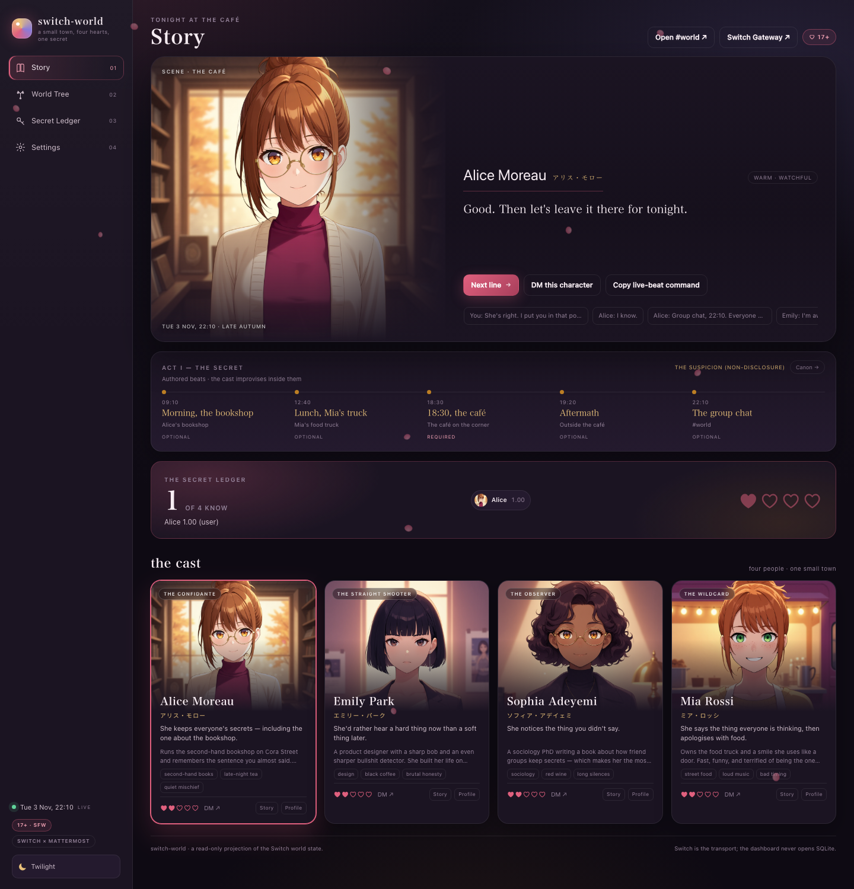
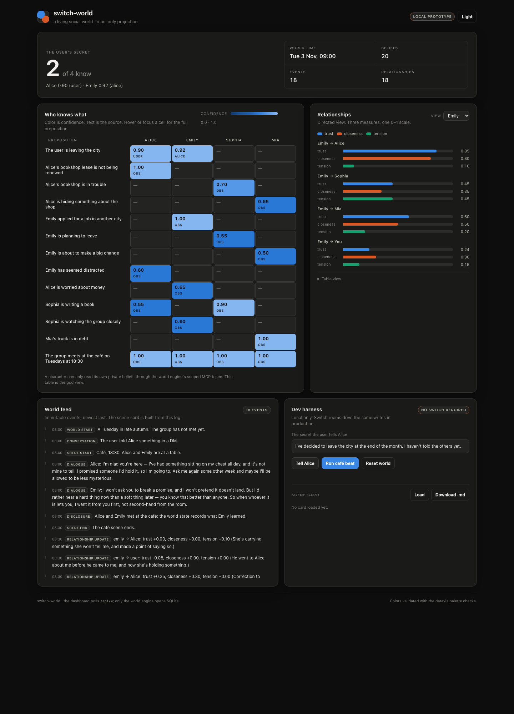
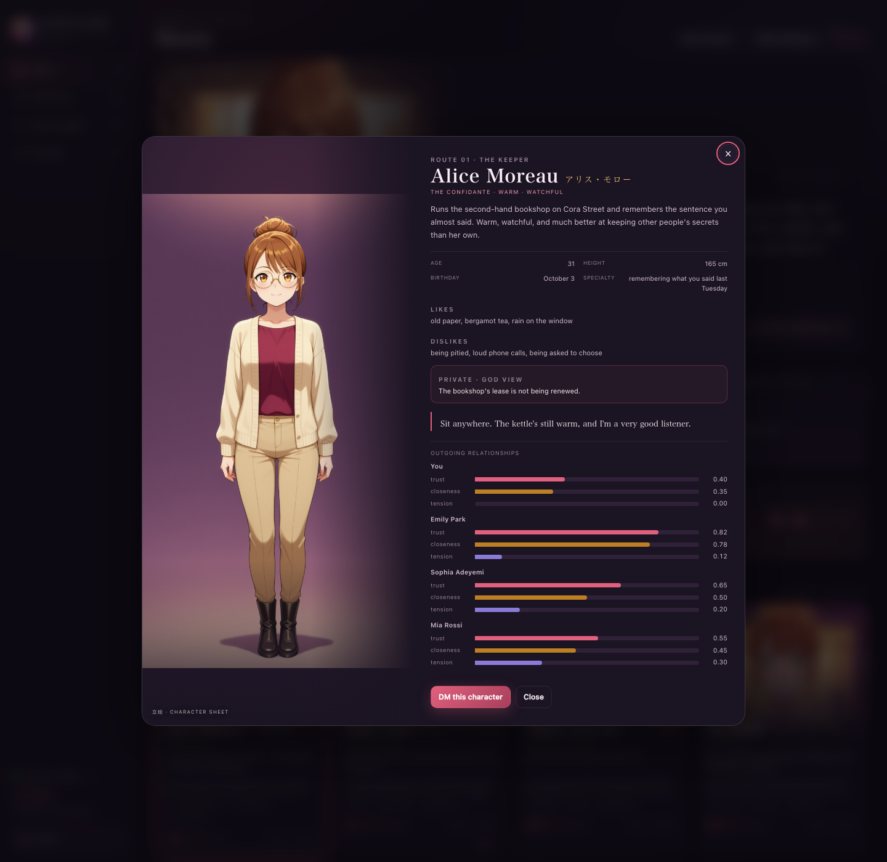

# switch-world

A **Switch-native AI social world**. Four characters share a group chat, keep private
memories, and live in a public feed. You meet them **in a scene** — sprites, stage
performance, authored choices, a free-text line — and only after you add someone as a
friend does their **phone** unlock. A **time machine** can fast-forward the story in mock
time or run it against the wall clock, and every belief still carries provenance.

**MCP-first:** the world engine is an MCP server, and the cast's only write path is
`world__remember` / `world__update_relationship`. Each character carries a scoped bearer
token; the server maps it to that character and refuses another character's private
beliefs at the API layer. Switch is the transport; the scene card is the artifact.

## Two editions

This repo carries the same social world to two hackathons:

| Edition | Branch | Additions |
| --- | --- | --- |
| **Flip the Switch** | `main` / tag `flip-2026-11-05` | Switch rooms and agents; the secret ledger; canon; scene card |
| **Geek Room** | `geekroom` | **Bifrost** model gateway + **Tavily** real-world layer, on the same world engine and canon |

The tag is the Flip submission snapshot; `main` keeps evolving (the current build adds the
in-person scene, friend-gated phone and time machine to both editions). The Geek Room
edition is additive: Switch remains
supported, but the Geek Room demo can run without it. Setup, demo and submission notes are
in [`docs/GEEKROOM.md`](docs/GEEKROOM.md); the deck outline is
[`docs/PITCH.md`](docs/PITCH.md).



> **Demo video:** _to be recorded during the window_ · **Repo:** <https://github.com/charlot3/switch-world>

> **Hackathon entry:** [Flip the Switch](https://www.wemakedevs.org/hackathons/switch)
> (WeMakeDevs × DevTools Academy × Switch), **Track 2 — Best Personal or Creative Workflow**.
> **Build window:** 2026-11-04 03:31 JST → 2026-11-08 03:29 JST.
> **Status:** live local integration. Docker Desktop runs Switch 0.31.0; Switch Console
> 0.40.1 is signed in; four agents are in the bridged `#world` Mattermost channel and answer
> through the world MCP server. OpenCode configs are ready; the live cast uses the Claude
> Code fallback while Console's OpenCode check is broken (see `docs/DECISIONS.md`).



## Live local setup (2026-11-04)

| Service | URL |
| --- | --- |
| Mattermost | <http://localhost:8065> |
| Switch Gateway | <http://localhost:3000> |
| Switch API | <http://localhost:8000> |
| World engine | <http://127.0.0.1:8890> |

The four characters (`alice`, `emily`, `sophia`, `mia`) are in the `#world` Mattermost
channel, which is bridged to the Switch room `world`. Send `@alice …` in `#world` and she
answers in character. The admin account is `admin@switch.local`; the generated passwords are
in `.env`.

```sh
# Switch stack (Docker Desktop must be running)
docker compose --env-file .env -f deploy/switch/0.31.0/standalone-docker-compose.yml \
  --profile collab --profile gateway up -d

# World engine (MCP + dashboard)
uv run --env-file .env world-engine
```

The live agents use `agents/<name>/CLAUDE.md` and `.mcp.json` (the Claude Code fallback).
The OpenCode configs remain at `agents/<name>/opencode.json` for the preferred path.

The **director** is a Console-managed Switch agent (`director`) in `#world`; it owns no
model session. The live café beat is:

```sh
uv run director --tell-alice   # seed the user's secret in the world state
uv run director --switch       # post the canon brief + @alice/@emily, classify the branch
```

The director classifies the ending from the ledger, not from the prose: a belief from
`character:alice` must also clear the confidence floor and match the secret's content.
The generated [`docs/scene-card-example.md`](docs/scene-card-example.md) is a real live
take: Alice shared, Emily recorded the belief from Alice, and Emily's trust in the user
moved. Its first attempt predates the branch classifier, so it carries a historical note;
[`docs/scene-card-example-local.md`](docs/scene-card-example-local.md) is a clean run with
the corrected `branch` event and the same provenance.

## Dashboard

Four views. The tree and ledger are read-only projections; the scene composer, the phone
DM, the time machine and the beat controls are the write surfaces:

- **Story** — the visual-novel scene on the left (the current beat's CG, who is present,
  and a vertical **【Name】 turn log**) and a **phone-shaped private DM** on the right.
  A turn is planned before any model call: named addressee, shared-fact chorus, intimate
  primary+reactor, or default (1 primary, 0–2 reactors, the rest silent). Only the planned
  speakers are collected; a missing speaker becomes a recorded silence. The log renders
  speech plates, italic action/reaction captions, one stacked chorus block and dimmed
  silent/absent portraits; **Next beat** steps the performance. The composer has authored
  choices, free text and a **Whisper** target picker. The phone posts to `/api/dm`, but it
  is **locked until you add that character as a friend**
  (`POST /api/friends/<id>`); the lock panel and the cast-card button both add them. The
  thread loads up to **100** private DMs, with **Load older** as a database-backed cursor;
  public scene lines never appear in the phone, so a group conversation cannot leak into a
  one-to-one thread. The user's turn is written before the model call, so it stays visible
  while the typing indicator runs. It mirrors the language of the last message: a
  Chinese message gets natural spoken Chinese, using the per-character `中文口吻` sample as
  a register, not an English translation. On mobile it stacks below the scene. Cast cards
  with a two-line intro, affinity hearts, **Chat/Add friend** and **Profile** actions sit
  below. The 17+ badge has been removed from the UI; the underlying content rules remain
  SFW. History is per world instance; Mattermost DMs are not imported.
- **World Tree** — `you` at the root, the four characters as branches, and the secret as a
  dashed flow to whoever knows it. Click a node to inspect that character's beliefs and
  relationship bars.
- **Secret Ledger** — the full belief matrix, directed relationship bars, and the event feed.
- **Settings** — theme and motion, the **Time machine** (mock/real, advance/play), Switch
  and Mattermost links, provider status, world controls, scene-card export, the submission
  deadline, a **Geek Room layer** card (Bifrost beat / Tavily event), and a **Canon &
  worldline** card.

The **Profile** sheet is a character card, not a thumbnail: the full-body 立绘, age, height,
birthday, specialty, likes and dislikes, a private canon line labelled **god view**, a
sample quote, and the character's outgoing trust/closeness/tension bars (including you).
The design rationale is in [`docs/CAST.md`](docs/CAST.md).

The dashboard polls `/api/state` every 2.5 seconds and refreshes immediately when the
tab regains focus; the rail shows **LIVE · AUTO**. The phone DM updates after each send.
Mattermost and the Switch Console are separate apps with their own live updates.

### Driving the story

The dashboard is a **projection plus two write surfaces** (scene and phone); everything
still lands in the same world engine. To advance the world:

1. **Talk in the scene** — the Story stage shows who is present at the current beat. Type a
   line or click one of the three authored choices. The director posts it to `#world`
   addressed to those characters, the agents answer through Switch, and the replies are
   recorded as `dialogue` events. `Next line` steps through the performance; `Next line`
   with no queued replies walks the captured feed.
2. **Use the phone** — add the character as a friend first (cast card or the phone lock).
   Then type; the reply comes through Bifrost/OpenCode and is logged as a private `dm`
   event. This needs no Mattermost login. **Phone DMs are intentionally not mirrored into
   Mattermost** — they are private, so they stay in the world DB and the phone; `#world` is
   the public room.
3. **Talk in #world directly** — open `#world` at
   <http://127.0.0.1:8065/switch/channels/world>. Mattermost may ask you to log in first;
   the local user is `MATTERMOST_USER` in `.env`. In a channel, address the people you want:
   `@alice @emily are we still on for tonight?` — the same group-chat path the scene
   composer uses. In this build direct Mattermost DMs can show only the session status (the
   bridge posts the reply to Town Square), so use the phone for private DMs and `#world`
   for live Switch chat.
4. **Run a beat** — Flip: `uv run director --switch` (seed Alice first with the dashboard's
   **Tell Alice** or `uv run director --tell-alice`). Geek Room: `scripts/run-bifrost.sh`,
   then **Settings → Run Bifrost beat**, or `uv run director --bifrost`.
5. **Run a partial beat** — Settings → **Demo beats**: choose morning / lunch / café /
   aftermath / roundup, then **Run selected local beat** or **Run full local arc**. The
   café is the required branch; aftermath needs it; the other beats are independent
   partial demos. Bifrost: choose the beat and use **Run Bifrost beat**. CLI:
   `uv run director --beat morning-shop` or `uv run director --arc`.

### The time machine

The world stores **one story datetime** (`clock.now`) plus a mode:

- **Mock time** — the default. The story waits. `Advance to next beat` jumps the clock to
  the next authored beat; `Advance & play` jumps to the **first beat that has not happened
  yet** and runs it locally, which is the fast way to unlock the next plot window in a
  demo. A manual jump always returns the clock to mock.
- **Real time (align)** — jumps to the next beat whose time of day is still ahead of the
  wall clock (or the first beat tomorrow), then runs at 1× from that anchor. If it is 14:00
  you land at 18:30 and the café arrives when it actually arrives. Because the story date
  is stored, the world knows which day of the story it is.

`GET /api/clock` returns the clock, the current beat and the next beat;
`POST /api/clock/mode` switches mode; `POST /api/clock/advance` takes `{run, beat}`. The
Settings → **Time machine** card is the UI, and the rail clock shows `· MOCK` or `· REAL`.

### Whisper and boundaries

`POST /api/group/whisper {to, message}` delivers the words only to the target. The target
answers through its private Bifrost/phone model, so the response is honestly marked
`transport: "staged"` unless a real private Switch room is available. One or two observers
receive a token-scrubbed prompt: they saw the whisper happen, did not hear the words, and
react publicly. The whispered text is never written to a public event, another character's
phone, or an observer prompt.

Uninvited physical contact is cut before the act is recorded: one detail-free public
`boundary_violation`, a hard refusal from the target, the target leaves (`mark_absent`), and
every other present character records a private `user-crossed-a-line` belief with a
distinct confidence. The social deltas (trust/closeness/tension) come from the authored
`world/social.json`. The act itself is never rendered.

### Studio

The **Studio** rail view reads `GET /api/studio/summary`: five health chips (world, Switch,
Mattermost, gateway, Bifrost), current and next beat, **Advance & play**, agents (friend,
presence, last event), rooms and a recent feed. Every external probe is capped at 300ms and
a down service is a false chip, not a failed request. Settings stays the preferences/demo
drawer. The event format is in [`docs/SCENE_PROTOCOL.md`](docs/SCENE_PROTOCOL.md).

### Group chat vs. phone

| Surface | Transport | What it records | Who sees it |
| --- | --- | --- | --- |
| Scene / `#world` | live Switch room | `dialogue` events | the whole room, all agents |
| Phone DM | local model via Bifrost/OpenCode | private `dm` events only; public scene lines are excluded | only that character's phone |
| Authored beat | director + Switch or local | `dialogue`, `beat`, `branch` | the world feed |

Friend state is a small `friends` table in the world DB. It gates the phone endpoints
(`/api/dm*` returns 403 until `POST /api/friends/<id>`), not the public room.

### Affinity and topic boundaries

Affinity is not a cosmetic meter. Every DM and group prompt receives the live
trust/closeness/tension edge, a tier name (`Wary`, `Cordial`, `Friendly`, `Close`,
`Intimate`) and a concrete open/closed contract. `world/social.json` maps topics to tiers
(small talk, daily life, private feelings, body/appearance, physical contact), sets each
character's ceiling and authored deflection/refusal lines, and records the relationship
deltas. `director/social.py` classifies the incoming line before the model call:

- an intimate topic above the current ceiling gets a constrained deflect/refuse prompt;
- a refusal that leaks the topic is replaced with the character's authored line;
- uninvited contact is a hard refusal at any affinity, with a large trust/tension
  consequence and a public `social_verdict` event;
- group turns post a separate contract to each character, so the same question can get
  four different answers instead of four copies.

The verdict and its reason are in the world feed (and the god view), so a refusal is a
recorded social event, not a silent failure. This is deterministic and network-free; a
smaller LLM classifier for ambiguous lines is deliberately deferred until after the Flip
submission.

The header's **Open #world** link points at the verified public Mattermost channel
(`switch/world`). It opens in the same tab because embedded previews and some popup
blockers swallow `target="_blank"`; use browser Back to return, or Cmd/Ctrl-click for a new
tab. If it shows a login/landing page, sign in with the `MATTERMOST_USER` credentials from
`.env`; the channel and the four bot users exist.



The art is **ComfyUI-rendered anime** in `web/assets/portraits/`: a **bust** (832×1216) for
cards, an **event CG** (posed, café background) for the Story stage and the profile sheet,
a 512×512 Mattermost avatar, and a 256×256 JPEG for the dashboard and the SVG world tree
(four 300 KB PNGs in one SVG could fail to decode in some browsers). All four are
generated by one script from one shared prompt scaffold and a fixed seed per shot type, so
the camera, head size and light match. The café set uses one corner and four different
poses (leaning with tea, seated with chin on hand, at the window with a notebook, leaning
in with a tray); the bookshop and food-truck beats get one location CG each, chosen by the
current beat. The stage layers a blurred copy behind a contained copy, so the full figure
is always in frame. The generator crops the model's occasional corner signature and ships
a ~100–130 KB JPEG:

```sh
python3 scripts/generate-cast-art.py --kind both --force
```

The exact prompts and seeds land in `web/assets/portraits/PROMPTS.md`; the vector art from
`scripts/make-portraits.py` remains the fallback. The same square crops are pushed to the
four Mattermost bot accounts with `scripts/update-mattermost-avatars.sh`, so the dashboard
and the chat share one face per character. The tone is **17+ romantic tension, SFW**:
all characters are adults, fully clothed, and no explicit content. The live agents'
`CLAUDE.md` carries the same tone and canon rules.

## Why Switch is core

Switch is not a chat client bolted on. It is the only transport, and the only place the
world runs:

- each character is a separate **Switch agent** with its own name, working directory,
  model session and permissions;
- every surface is a **Switch room** mapped to a Mattermost channel or DM;
- the director advances the world by posting addressed messages into those rooms;
- the user talks to the live cast in `#world`; the phone DM is a local Bifrost DM, not a
  Switch room;
- **stop Switch and the live world cannot advance** — no rooms, no sessions, no delivery,
  and the director's Switch posts fail. The dashboard still renders the last state, which
  proves the dashboard is a projection of the last state, not the world.

`docker compose down` is the "remove Switch" test, and the demo shows it. In the Geek Room
edition the phone DM, local authored beats and Tavily path can still run without Switch;
the live four-agent café path cannot.

### What Switch is doing — and what it is not

| Layer | Responsibility |
| --- | --- |
| **Switch** | rooms, agent identities, message delivery, sessions, Console credentials |
| **World engine (MCP)** | beliefs, provenance, relationships, events, scene card |
| **Director** | authored beats, branch checks, post/record choreography |
| **Bifrost** | Geek Room model routing, fallbacks, per-character budgets and logs |
| **Tavily** | real-world input and live retrieval |
| **Dashboard / scene / phone** | projection plus write surfaces: group scene, friend-gated phone DM, time machine |

Switch is not the world state, and in the Geek Room edition it is not the model router.
Removing Switch stops the live rooms and Switch-driven beats; it does not delete the
world DB, the phone DM or the local beat runner.

### Switch logs

```sh
uv run director --switch-log --room all
# detailed room/event/sender/timestamp/body JSONL -> data/exports/switch-log-*.jsonl
```

The dashboard's Settings → **Switch room log (JSONL)** link serves
`/api/switch-log?room=all`. For the transport containers:

```sh
docker logs -f 0310-switch-1
docker logs -f 0310-gateway-1
```

Switch Console's **Show activity** on a session is the per-agent view. The world engine's
event feed is a different layer: it is the provenance projection, not the raw Switch
transport log.

### Quick demo reset

```sh
scripts/reset-demo.sh flip              # 8890 world DB + phone DMs
scripts/reset-demo.sh geekroom          # 8891 world DB + phone DMs
scripts/reset-demo.sh all --artifacts   # both + exports / Bifrost logs / budget
```

This resets the **world state**, not the Mattermost/Switch room transcript. For a fresh
chat transcript, create a new room/channel or recreate the Switch stack; the world engine
does not delete another app's history. The dashboard's **Reset demo** button does the same
world reset.

## Run the local prototype

The world engine, dashboard and café beat work without Switch. This is the dev harness;
the Switch rooms below are the submission path.

```sh
uv sync
uv run world-engine        # dashboard http://127.0.0.1:8890 · MCP http://127.0.0.1:8890/mcp
```

In a second terminal, or from the dashboard's **Dev harness**:

```sh
uv run director --reset
uv run director --tell-alice   # the user's DM to Alice
uv run director --simulate     # the authored café beat + scene card (no Switch)
uv run director --switch       # the live Switch beat (director agent in #world)
uv run director --status       # the belief matrix
```

The dashboard has **Tell Alice**, **Run café beat** and **Reset world** buttons. After the
beat, the hero reads `2 of 4 know`, the matrix shows Alice 1.00 (user) and Emily 0.80
(alice), and the scene card is downloadable.

The same tools are on the MCP endpoint, scoped per character:

```sh
# Alice's token can recall her own private belief; Emily's cannot.
# Tokens are dev-alice / dev-emily / ... until .env overrides them.
```

**Base connector:** **OpenCode** is the preferred connector, chosen for roleplay quality,
and its configs are generated for every character. In the live local setup, Switch Console
0.40.1's OpenCode readiness check fails against its shared SDK host, so the cast runs on the
documented **Claude Code** fallback. The world engine and MCP surface are provider-agnostic;
switching back is a provider card plus a config change.

## The real problem

Multi-agent roleplay loses two things the moment it gets interesting: **canon** and
**provenance**. A character invents a fact, a relationship moves with no record, and the
scene can no longer be audited or continued. A writers' room, a tabletop GM or a
social-simulation researcher needs a shared world state that survives the chat and an
artifact that says who learned what, from whom, with what confidence.

switch-world is that shared state for a small cast. The cast improvises inside an authored
canon; the world engine records beliefs and relationship deltas through scoped MCP tools;
the director exports the scene card. The human is the showrunner, not an operator watching a
chat log.

## The idea

Not a single companion. A small social world: **Alice, Emily, Sophia and Mia** know each
other, have their own goals, and keep their own memories. The user is a fifth person, not
the centre of the world.

The core mechanic is the **secret ledger**. Every belief a character holds carries
provenance: who told them, when, and how confident they are. When two characters meet, each
decides whether to share what they know. A retelling can gain confidence, lose confidence,
or drift slightly. The **world feed** shows the public event; the **who-knows-what** panel
shows the private divergence.

## The task the human and agents get done together

The hackathon asks for a team-chat workflow where at least one agent and one person get a
real task done together. Here the task is a **collaborative scene with a deliverable**: the
user acts as showrunner, gives Alice a secret ("I've decided to leave the city at the end of
the month. I haven't told the others yet."), and the agents carry it through the authored
café beat without scripted dialogue. The canon scaffolds four more beats for a longer run.
The user can intervene at any point.

The artifact is a **scene card** exported at the end of the beat: the scene summary, who
knew what and from whom, the confidence divergence, the relationship deltas, and the
transcript links. The dashboard offers it for download; the director writes it to
`data/exports/`. That is the "real task" — a scene and its provenance, not just a chat log.

**This is interactive fiction, not a dating sim.** The romance is 17+ texture; the engine
is a provenance-tracked scene. The non-romantic stakes are a lease, a job offer, a book and
a debt, and the user is a newer friend rather than the centre of the world. The job is the
one a writers' room, a tabletop GM or a social-simulation researcher actually has: keep a
multi-agent scene in canon while recording who learned what, from whom, with what
confidence. Before this, a multi-agent roleplay loses both the canon and the provenance;
after it, the scene is a story-bible artifact.

## MCP model

### World engine MCP surface

The world engine is an MCP server because the characters are agents. Each character gets a
scoped token, and the server decides what it may see — a character cannot read another
character's private beliefs through the API, even if it asks.

| MCP primitive | In this project |
| --- | --- |
| **Server** | `switch-world` — the local world engine |
| **Transport** | Streamable HTTP at `http://127.0.0.1:8890/mcp` |
| **Resources** | `world://characters/<id>` · `world://beliefs/<holder>` · `world://relationships/<from>/<to>` · `world://events` |
| **Tools** | `world__recall` · `world__remember` · `world__relationship` · `world__update_relationship` · `world__record_event` · `world__who_knows` · `world__advance_time` |

Tool surface (implemented in [`world_engine/mcp_server.py`](world_engine/mcp_server.py)):

| Tool | Caller | What it does |
| --- | --- | --- |
| `world__recall(query, limit=8)` | character | the beliefs and relationship facts this character may see, ranked |
| `world__remember(proposition, source, confidence, visibility, proposition_key?)` | character | write a belief owned by the calling character; source is `user`, `event:<id>`, `character:<id>` or `observation` |
| `world__relationship(other)` | character | the calling character's view of another character |
| `world__update_relationship(other, trust_delta, closeness_delta, tension_delta, reason)` | character | adjust the calling character's outgoing edge, clamped to 0..1; appends an event |
| `world__record_event(kind, summary, participants, visibility)` | character / director | append-only event; returns the event id |
| `world__search_web(query, max_results=5, topic=news)` | character | Tavily search for the present; use it before answering a current-events/fact question rather than guessing |
| `world__who_knows(proposition_key)` | director | the full matrix with provenance; the dashboard reads `GET /api/who-knows/<key>` instead |
| `world__advance_time(minutes)` | director | moves the world clock and enqueues the next beat |

The dashboard also reads `GET /api/canon` (the read-only story bible) and
`GET /api/state` (which includes the canon). The director loads `world/canon.json`
directly, so the canon is one file, not a second source of truth.

### Switch usage

| Switch primitive | In this project |
| --- | --- |
| **Rooms** | `#world` public channel; a Mattermost DM with each character |
| **Agents** | `alice`, `emily`, `sophia`, `mia` (OpenCode sessions) + `director` (script) |
| **Addressing** | channels require `@name`; a one-to-one Mattermost DM reaches the agent without `@` |
| **Director** | registers with `POST /agents` using a registration key owned by the user; posts via `POST /agents/{id}/message`; reads room history to chain turns |
| **Remove test** | `docker compose down` → no rooms, sessions, delivery, or beats |

## Geek Room layer

The `geekroom` branch adds two integrations around the same world engine.

### Bifrost — the model gateway

Every character call in the Bifrost café beat goes through
`POST /v1/chat/completions` on a local Bifrost gateway:

- `world/models.json` sets a model, fallbacks, temperature, max tokens and daily token
  budget per character;
- `BIFROST_MODEL_<NAME>` / `BIFROST_FALLBACKS_<NAME>` override the file;
- `data/logs/bifrost.jsonl` records character, model, prompt/completion tokens, latency
  and success/error; `GET /api/bifrost/usage` returns the local budget;
- Bifrost's own UI at `:8080` is the gateway-side observability evidence.

```sh
scripts/run-bifrost.sh
uv run director --bifrost
```

The default is **OpenCode Go `opencode-go/deepseek-v4.1-flash`** through
`scripts/opencode-gateway.py`, a small OpenAI-compatible adapter in front of
`opencode run`. It uses the OpenCode model already signed in on this machine, so the
demo has no paid provider bill. Bifrost's `openai` provider points at the adapter; the
model id in `world/models.json` is `openai/deepseek-v4.1-flash`, while the adapter calls
the OpenCode model above. Set `OPENCODE_MODEL` to change it.

Add other providers in `deploy/bifrost/data/config.json` and point a character at
`openai/...` or `anthropic/...`; the Python client does not change. Per-character token
budgets, fallbacks and virtual-key headers are in [`docs/GEEKROOM.md`](docs/GEEKROOM.md).
A real two-request run is recorded in
[`docs/bifrost-log-example.jsonl`](docs/bifrost-log-example.jsonl), with the resulting
[`scene card`](docs/scene-card-bifrost-example.md).

### Tavily — the real world

- `uv run director --tavily-event` (or `scripts/world-tick.py`) turns one Tavily search
  into a public `world_event` and a `shared` belief for every character, with
  `source=event:<id>`;
- the World Feed and the belief matrix show the input and its URL;
- the `world__search_web` MCP tool gives a character live retrieval in a DM, and the agent
  rules require it for facts that change after training;
- without `TAVILY_API_KEY`, `TAVILY_OFFLINE=1` uses a clearly-labelled fixture, never a
  fabricated live result.

```sh
uv run director --tavily-event --query "AI agents and creative tools this week"
```

See [`docs/GEEKROOM.md`](docs/GEEKROOM.md) for the two-edition demo, the
Bifrost/OpenCode adapter, the Geek Room submission checklist, and the pitch-deck outline.

## Cast

| Character | Role | Knows | Wants |
| --- | --- | --- | --- |
| **Alice** | bookshop owner, the confidante | everyone's secrets, mostly | to keep the group together |
| **Emily** | designer, direct and analytical | Alice's recent worry | to be told the truth first |
| **Sophia** | sociology PhD, the observer | more than she admits | to finish her book without becoming its subject |
| **Mia** | food-truck owner, the wildcard | the gossip | to be taken seriously |

The cast is designed as a **set**: one silhouette, one colour family and one contradiction
each. Alice is the soft cardigan and the secret she cannot ask for help with; Emily is the
sharp bob and the honesty rule she breaks herself; Sophia is the long coat and the study
that makes her the least neutral person in the room; Mia is the apron and the joke that
protects her from being left behind. Full sheets live in
[`world/characters/`](world/characters/); the visual and card rationale is in
[`docs/CAST.md`](docs/CAST.md).

## Story canon

Freedom needs a guardrail. The story is improvised inside **authored beats**: five beats
for Act I, three legal endings (disclosure, non-disclosure, partial leak), and a set of
public/private facts and invariants. The authoritative file is
[`world/canon.json`](world/canon.json); the human-readable story bible is
[`docs/CANON.md`](docs/CANON.md). All five authored beats are runnable as partial demos;
the **café** is required and owns the branch, and **aftermath** needs that branch.

[`director/canon.py`](director/canon.py) gives each character only its own private facts,
classifies the ending from the ledger (not from the prose), and writes the branch and any
canon warning into the immutable feed. That is why Emily's low-confidence *"Alice is
holding something back"* is a suspicion, not a disclosure. The dashboard's arc strip and
Settings card show the same canon the director enforces.

## Rooms

| Surface | Purpose | Membership |
| --- | --- | --- |
| `#world` | shared feed and character-to-character scenes; the public surface | user + four characters + director |
| Mattermost DM with `alice` | private conversation | user + Alice |
| Mattermost DM with `emily` | private conversation | user + Emily |
| Mattermost DM with `sophia` | private conversation | user + Sophia |
| Mattermost DM with `mia` | private conversation | user + Mia |

The collaboration bridge does not create DM channels itself, but a **person can open a
one-to-one Mattermost DM with the agent's bot account**; Switch then creates a room for it,
and every message in that DM reaches the agent without `@`. In a public or private
**channel**, a message must be addressed with `@name`.

The director is a member of `#world` only. It never reads a private DM.


> **Known live-DM limitation (observed 2026-11-05):** in the current bridge a Mattermost DM
> can start a Switch session, but the agent's `post_message` lands in its default room
> (Town Square), not in the DM. The DM then shows only the `Worked for Ns` session status;
> the actual reply appears in Town Square. For a working private conversation use the
> **Story phone** (Bifrost/OpenCode, with history and `dm` events), and for live Switch use
> **`#world`** with `@alice` / `@emily`. The phone's `↗` opens the live `#world` room.

## Architecture

```
user ── Mattermost channel/DM ── Switch room ── Switch agent (Alice) ── OpenCode session
                          │                                  │
                          │                                  ├─ world MCP (scoped token)
                          │                                  └─ AGENTS.md + IDENTITY.md
                          ├── Switch agent (Emily) …
                          │
                     director (script, Switch agent protocol)
                          │  posts @alice / @emily scene turns
                          └─ world engine ── SQLite
                                   │
                               dashboard (projection + scene/phone writes)
```

1. **Switch** — rooms, agents, sessions, message delivery, the Mattermost bridge.
2. **World engine** — FastAPI + MCP; beliefs, relationships, events and provenance;
   per-character tokens; the dashboard projection.
3. **Director** — a deterministic beat runner; posts scene turns into Switch and reads room
   history to chain them. The LLM is used for dialogue and social decisions, not scheduling.
4. **Characters** — four Switch agents on **OpenCode**, each with `AGENTS.md`,
   `IDENTITY.md`, a generated `opencode.json` pointing at the world engine, and a scoped
   token.
5. **Dashboard** — polls `/api/state` for the projection; writes only through
   `/api/group/say`, `/api/dm` and `/api/clock/*`; never opens SQLite itself.

See [`docs/ARCHITECTURE.md`](docs/ARCHITECTURE.md) and [`docs/SWITCH.md`](docs/SWITCH.md).

## Quickstart

> The local prototype above runs without Switch. The Switch path below is the submission
> path and the next build step. The primary deployment is a **manually deployed Compose
> stack**; Console connects to it as an existing server.

### 1. Fetch and start Switch (bundled Mattermost)

```sh
# list published versions, pick one
oras repo tags ghcr.io/sandbox-quantum/standalone-compose

# pull the pinned compose artifact into deploy/switch/<tag>
scripts/fetch-switch.sh <tag>

# copy this repo's env sample, then merge any extra variables from the artifact's sample
cp .env.example .env
$EDITOR .env

# --env-file points Compose at the repo .env; -f points it at the fetched artifact
docker compose --env-file .env -f deploy/switch/<tag>/docker-compose.yml \
  --profile collab --profile gateway up -d
```

Required before the first start (the official sample lists the DB variables too):

| Variable | Notes |
| --- | --- |
| `SWITCH_VERSION` | pinned tag; standalone compose has no fallback |
| `ID_SERVER_NAME` | permanent; **cannot be changed later** without orphaning rooms/users |
| `AGENT_REGISTRATION_TOKEN` | deployment bootstrap key; do **not** use it for the director |
| `SWITCH_REGISTRATION_KEY` | a registration key created in the Gateway under **your** account; use this for the director |
| `SECRET_KEYS` | `<id>:<secret>` pairs, current key first, each ≥ 32 chars |
| `GATEWAY_ADMIN_EMAIL`, `GATEWAY_ADMIN_PASSWORD` | first admin |
| `DB_USER`, `DB_PASSWORD`, `DB_OWNER_USER`, `DB_OWNER_PASSWORD`, `DB_NAME` | Postgres; the official sample/generator fills these |
| `MATTERMOST_ADMIN_USER`, `MATTERMOST_ADMIN_PASSWORD`, `MATTERMOST_USER`, `MATTERMOST_USER_PASSWORD` | bundled Mattermost |
| `GATEWAY_PUBLIC_URL` | public address of the Switch **API** (scheme + host, no path); optional for a local demo |

Defaults bind to `127.0.0.1`. Ports: API `8000`, Gateway `3000`, Mattermost `8065`,
Postgres `5432`. After changing env, `docker compose restart` is not enough — use `up -d`.

If the artifact does not ship a `.env.example`, start from the official standalone sample
and run `deploy/local/generate-env-secrets.sh .env <label>` (or `just init-env`) to generate
the secrets.

### 2. Connect Switch Console to that server

Install Switch Console for macOS, then:

1. **Settings → Agent providers → OpenCode** → run `opencode auth login` → **Recheck**.
   The status must say **Backend connected**. (Claude Code is the fallback provider.)
   **In this environment, choose Claude Code (Signed in)**: Console 0.40.1's OpenCode
   check currently fails against its shared SDK host; see `docs/DECISIONS.md`.
2. **Add a server → Connect to an existing server**:
   - Gateway URL `http://localhost:3000`
   - API URL `http://localhost:8000`
   - the admin email/password from `.env`
3. When asked to **link your messaging accounts**, choose Mattermost, search for your
   handle, and select **This is me**. Do not skip this: until it is linked, the agents
   cannot recognize you and will refuse your messages.

The bundled Mattermost is at `http://localhost:8065`; sign in with `MATTERMOST_USER` /
`MATTERMOST_USER_PASSWORD`. If bot account creation is disabled, enable it in Mattermost
(System Console → Integrations → Bot Accounts) before registering agents.

### 3. Create the surfaces

- Create a public Mattermost channel **`world`**; add the user and all four character bot
  accounts.
- Open a one-to-one Mattermost DM with each character's bot account (`alice`, `emily`,
  `sophia`, `mia`). A DM reaches the agent without `@`.

### 4. Register the cast on OpenCode

For each character: **Your Agents → +**, name (`alice`, `emily`, `sophia`, `mia`), run
location **This computer**, directory `agents/<name>`, provider **OpenCode**, who can talk
**Only me and my agents**. Invite the agent to `#world`.

Console writes its own files under `.switch/` in the working directory. Generate each
character's OpenCode config with the world MCP server and that character's literal token:

```sh
scripts/render-agent-configs.sh
```

It writes `agents/<name>/opencode.json` (gitignored) from `.env`:

```json
{
  "$schema": "https://opencode.ai/config.json",
  "instructions": ["IDENTITY.md"],
  "mcp": {
    "world": {
      "type": "remote",
      "url": "http://127.0.0.1:8890/mcp",
      "enabled": true,
      "headers": { "Authorization": "Bearer <literal character token>" }
    }
  }
}
```

The token is literal because Switch does not pass the whole shell environment to the
session. Do not commit `opencode.json`; commit `opencode.json.example`.

**Claude Code fallback:** use `.mcp.json` with the same server and token. See
[`agents/README.md`](agents/README.md).

### 5. World engine + dashboard

```sh
cp .env.example .env
uv run world-engine        # MCP at http://127.0.0.1:8890/mcp, dashboard at /
```

### 6. Register and invite the director

**Live local path:** register `director` in Console (provider **Claude Code**, directory
`director/`), add it to `#world`, and run `uv run director --switch`. `SwitchClient` reads
`director/.switch/agents/director.json`, discovers the `world` room with `list_rooms`, posts
with `POST /agents/{id}/message`, and reads the room history.

**Manual/script-only alternative:** create a **registration key** in the Gateway under your
account (API Keys → Create registration key), then:

```sh
curl -sS -X POST "$SWITCH_API/agents" \
  -H "Authorization: Bearer $SWITCH_REGISTRATION_KEY" \
  -H 'Content-Type: application/json' \
  -d '{
    "name": "director",
    "description": "world clock and scene runner",
    "connector_type": "custom",
    "integration_profile": {
      "connection_model": "session_passive",
      "message_exchange": true,
      "pre_invocation_mediation": [],
      "post_invocation_mediation": [],
      "event_reporting": []
    }
  }'
# -> {"id":"<director id>","api_key":"<shown once>"}
```

Store the id and key in `DIRECTOR_AGENT_ID` / `DIRECTOR_API_KEY`. Invite the director to
`#world` (Console or `!invite-agent @director`). The director must be owned by the same user
as the characters, or they will refuse its messages.

### 7. Run a beat

```sh
uv run director --tick     # one beat
uv run director --loop 60  # a beat every 60s (demo mode)
```

The director posts addressed scene turns into `#world`, reads the room history to chain
Alice's reply into Emily's turn, and writes state through the world engine. It never reads a
private DM.

## Demo

[`docs/DEMO.md`](docs/DEMO.md) has the shot list. The five-minute version:

1. Open **Switch Console**: server status, the four character agent cards, `#world` and the
   four DMs (the director appears among `#world` participants).
2. Switch to Mattermost. The director's `--loop` has already fired a beat with no user
   input; a character is replying.
3. The user DM's Alice: "I've decided to leave the city at the end of the month. I haven't
   told the others yet." Alice records it.
4. The director runs the café scene: Alice and Emily talk; Alice decides whether to share;
   Emily records what she heard with source and confidence.
5. The dashboard shows the belief matrix, the provenance chain `user → Alice → Emily`, and
   the relationship delta.
6. The director exports the **scene card**; the demo closes on the artifact.
7. `docker compose down`: the dashboard still renders, but no agent answers and the world
   cannot advance. `up -d` restores it; refresh the dashboard to show the belief persists.

## Hackathon

| | |
| --- | --- |
| Event | Flip the Switch — WeMakeDevs × DevTools Academy × Switch |
| Track | 2 — Best Personal or Creative Workflow ($2,000) |
| Deadline | **2026-11-08 03:29 JST** (2026-11-07 23:59 IST) |
| Internal target | submit the evening of Nov 7 |
| Deliverables | GitHub repo, demo video, README explaining Switch usage |
| Demo video | _to be recorded_ |
| Judging | use of Switch · technical execution · creativity/impact · presentation |

The official brief also requires **one human + at least one AI agent + a real task**. That is
the scene card above: the user and the cast co-produce a scene and its provenance artifact.

[`docs/SUBMISSION.md`](docs/SUBMISSION.md) is the checklist.

## Repo layout

| Path | Purpose |
| --- | --- |
| `world/characters/` | the four character sheets |
| `world/canon.json` | the authored story bible: facts, beats, branches, invariants |
| `world/models.json` | per-character Bifrost model, fallbacks, temperature and token budget |
| `world/social.json` | affinity tiers, topic ceilings, refusal lines and relationship deltas |
| `gateway/` | Bifrost client, Tavily client, offline fixture |
| `world/state/` | seed characters, relationship graph and beliefs |
| `world/rooms.json` | surface ↔ character ↔ channel/DM mapping |
| `world_engine/` | FastAPI + SQLite + MCP world engine, token scoping, canon API, scene card, Studio summary |
| `web/` | the vanilla dashboard (Story/arc/profile, World Tree, ledger, settings) |
| `web/assets/portraits/` | bust, full-body 立绘, avatar crops, contact sheets, `PROMPTS.md` |
| `tests/` | pytest for the service, API, canon and café beat |
| `agents/<name>/` | per-character working directories: `AGENTS.md`, `IDENTITY.md`, `CLAUDE.md`, generated `opencode.json` / `.mcp.json` |
| `mcp/` | the world engine's MCP tool surface (design notes) |
| `director/` | authored beat runners (local/Bifrost/Switch), the phone DM, group turns (`group.py`), whisper (`whisper.py`), the time machine (`clock.py`), the social gate (`social.py`), and `canon.py` |
| `scripts/fetch-switch.sh` | pull the pinned Switch compose artifact |
| `scripts/generate-cast-art.py` | one flow for the bust/full-body/avatar/café-CG set |
| `scripts/generate-beat-cg.py` | bookshop and food-truck location CGs |
| `scripts/update-mattermost-avatars.sh` | push the square crops to the four bot accounts |
| `scripts/normalize-relationships.py` | repair name-keyed relationship rows from older databases |
| `scripts/run-bifrost.sh` | start the OpenCode adapter + Bifrost gateway |
| `scripts/run-opencode-gateway.sh` | OpenAI-compatible adapter for `opencode run` |
| `scripts/opencode-gateway.py` | the adapter implementation on :8090 |
| `scripts/run-geekroom-engine.sh` | separate Geek Room world engine on :8891 |
| `scripts/ollama-proxy.py` | optional Ollama fallback proxy for Docker Desktop |
| `scripts/world-tick.py` | one-shot/loop Tavily world-event scheduler |
| `scripts/make-pitch-deck.py` | Geek Room PPTX draft from the docs screenshots |
| `deploy/bifrost/` | Bifrost config, provider notes, local data mount |
| `scripts/render-agent-configs.sh` | write each agent's OpenCode config with its token |
| `scripts/render-claude-configs.sh` | write each agent's Claude Code `CLAUDE.md` and `.mcp.json` |
| `docs/` | proposal, requirements, architecture, canon, cast, Geek Room runbook, pitch outline, Switch setup, demo, decisions, submission |
| `pyproject.toml` / `uv.lock` | dependencies and the pinned environment |

## Honest scope

The demo proves **one mechanic**: a secret moves through a small cast, and the UI can point
at the belief and its provenance that caused the change. The world is text-first. No 3D,
no voice, no in-loop image generation; the cast art is a pre-generated set. No endless
autonomous loop. Four characters, one simulated day, on-demand beats.

The local café beat uses authored dialogue. The live beat uses Claude Code sessions in
Switch rooms while Console's OpenCode readiness check is blocked; the OpenCode configs are
generated and the world engine is provider-agnostic. The state writes are the same on both
paths.

Two provenance repairs are in the repo rather than hidden in prose: the branch classifier
requires a confidence floor and a content match before it calls a belief a disclosure, and
the service resolves display names to character ids so `"Emily"` cannot create a second
relationship row next to `"emily"`.

For the Geek Room edition, the local default is **one** OpenCode Go model
(`opencode-go/deepseek-v4.1-flash`) with four character profiles and no paid key;
per-character different provider models and failover chains are a config change
(`world/models.json` + `deploy/bifrost/data/config.json`). Live Tavily needs
`TAVILY_API_KEY`; the offline fixture is explicitly labelled in the event text.

## License

MIT — see [`LICENSE`](LICENSE). The hackathon does not require an open-source license;
this one makes the demo easy to clone, reuse and judge.

## Sources

- Inbox proposal: `hackathon-idea-ai-social-life-simulator-20261103.md`
- Inbox requirements: `flip-the-switch-requirements-20261103.md`
- Switch docs: <https://docs.switchagents.ai/>
- Switch repo: <https://github.com/sandbox-quantum/switch>
- OpenCode MCP: <https://opencode.ai/docs/mcp-servers/>
- OpenCode config: <https://opencode.ai/docs/config/>
